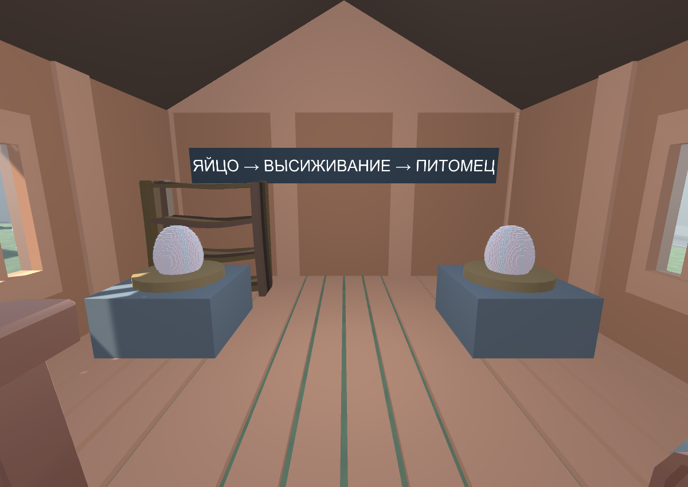
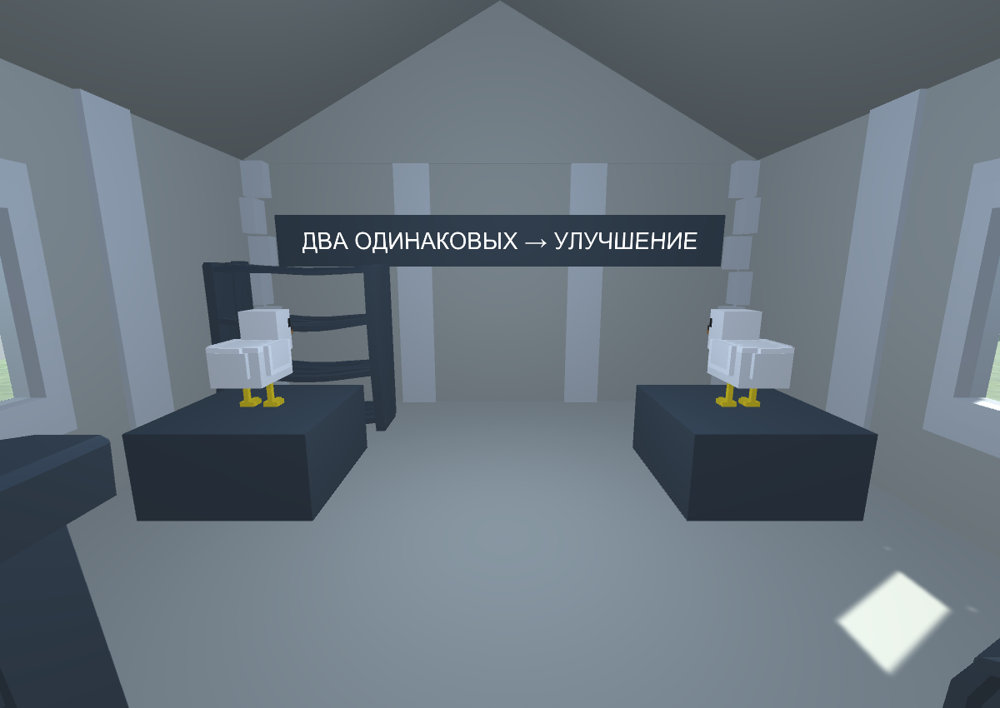
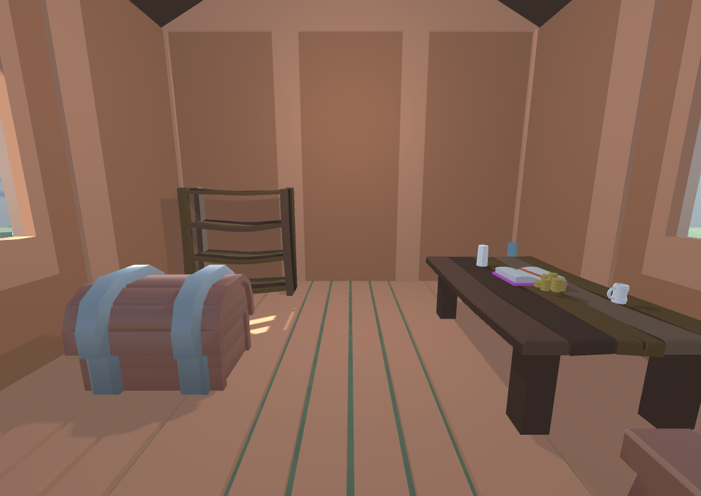
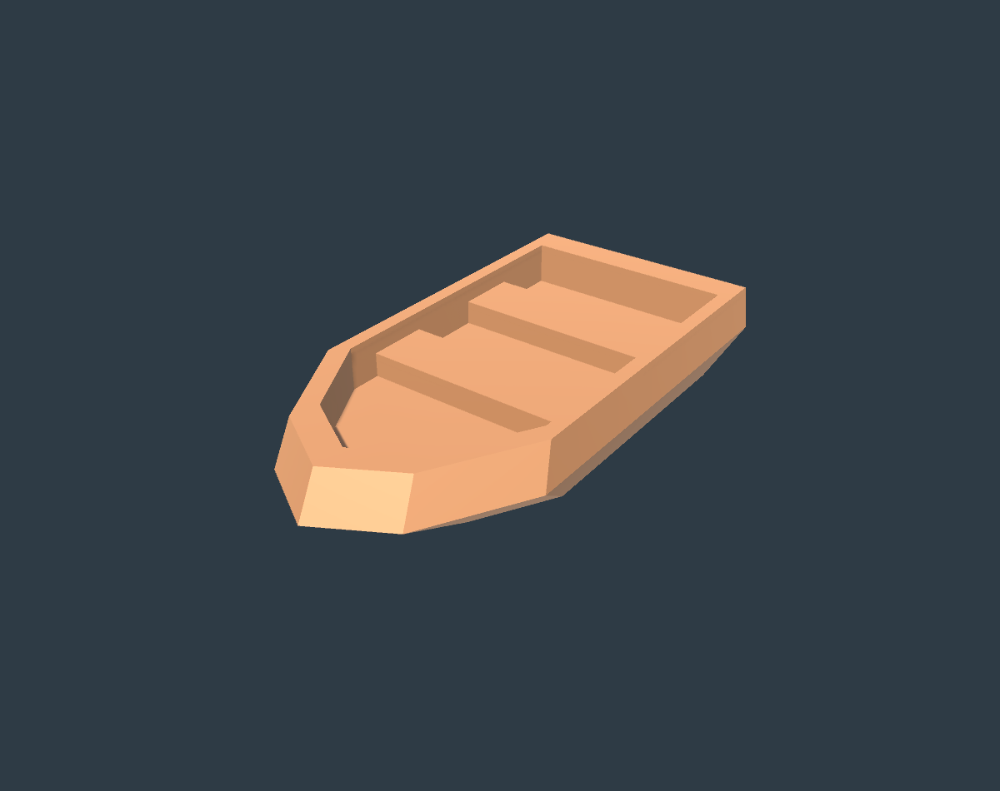
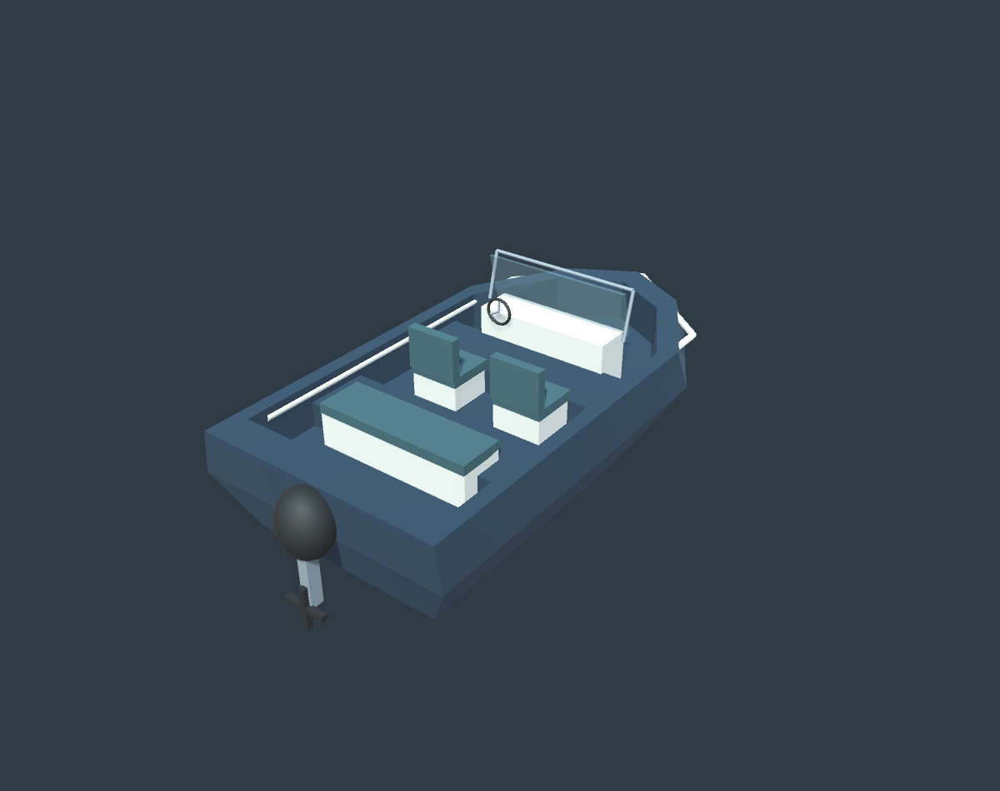
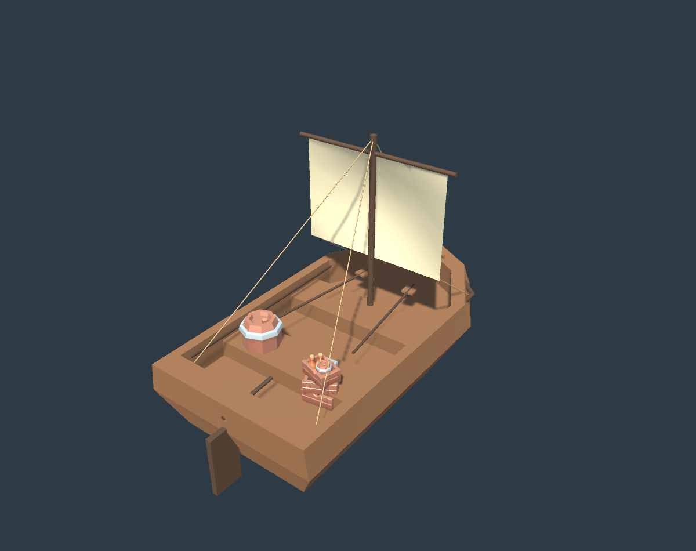

# Замок игровых сервисов

**Текущая версия — DB-ON-070:** здания заменены на реальные сервисы исходного Castle; лодки — на BoardController и новый вариант с сохранёнными точками управления/топлива. Подробности и ограничения проверки: [GAME_ALIGNED_CASTLE.md](GAME_ALIGNED_CASTLE.md). Ниже сохранена история прежнего макета; профессии, питомник и объединение больше не являются назначением домов этой сцены.

2026-10-06, DB-ON-063. Открытая сцена: `Assets/Scenes/CastleServicesWorkshop.unity`. Общий префаб: `Assets/Prefabs/Workshop/CastleServices/CastleServices_01.prefab`.

За основу взята группа Visual существующего `Assets/Prefabs/Locations/Castle.prefab`: башни, стены, ворота и баллисты. Она уменьшена до 45% и выровнена по земле. После правки DB-ON-065 посередине оставлен свободный зазор 7 единиц под водную систему основной игры; собственная река удалена. Шесть домов взяты из сохранённой коллекции мастерской; изменения сделаны в экземплярах нового замка. Исходный Castle, мастерская и шесть исходных префабов не редактировались. Build Settings не менялись.

## Дома и игровые основания

| Дом | Положение x,z | Основа | Назначение и актуальный код |
|---|---|---|---|
| Снабжение | -12,-14 | WoodenWorkshop_Wide_03 | Покупка вещей: ItemStore/StorePoint + GeneralStore; расширенный ассортимент BoatShop/SpecialShopPoint. Наковальня и верстак служат оформлением, отдельная механика ремонта здесь не придумана. |
| Оружейная | 12,-14 | StoneArmory_Wide_03 | Покупка оружия через ItemStore/StorePoint и существующую коллекцию GunStore. Две стойки, оружие, сундуки, стол учёта. |
| Скупщик | -12,0 | WoodenHall_Tall_02 | Сдача предметов и трофеев через SellPoint, StoreType.Items/Enemies; выдача MoneyBag. Кровать заменена сундуком добычи, добавлены монеты и ящики. |
| Профессии | 12,0 | StoneCaptainHall_Tall_02 | Выбор профессии через ProfessionNpcPoint и ProfessionSelectionPanel, каталог Resources/Professions/ProfessionCatalog.asset. Капитанский стол, архив, знамёна. |
| Питомник | -12,14 | WoodenCottage_01 | Высиживание яйца через EggNestPoint/EggHatchingManager; выбор спутников через AnimalLoadoutPoint. Два демонстрационных яйца на гнёздах, стол смотрителя, хранилище и полка. |
| Объединение | 12,14 | StoneCottage_01 | AnimalMergePoint/AnimalMergeSelectionPanel: два животных одного вида и стадии, ожидание и получение следующей стадии согласно EggHatchingManager. Две демонстрационные курицы на подставках. |

От южных ворот сначала доступны покупки и снабжение, затем сдача добычи и профессии, дальше развитие животных. Все двери обращены к реке, дома стоят на двух берегах. У каждого дома вывеска и три пустых Transform в `14_Interaction_Anchors`: Approach, якорь соответствующего сервиса и Output_Point.

DB-ON-064: вместо дороги сделано русло шириной 8 и длиной 69, проходящее через оба воротных проёма; вода около y=-0.28, дно y=-1.10. Земля разделена на два берега, прежняя плита под руслом удалена. Все дома опущены на 0.48: полы и крыльца на уровне берега y=0.20; лестницы у шести входов удалены. Мостов нет, водная поверхность без твёрдой коллизии. Это геометрия реки для макета; лодка и игровая физика воды ещё не подключены.

**Актуальное состояние DB-ON-065:** собственная вода, дно, рябь и набережные DB-ON-064 удалены. Зазор между берегами — 7.000 (x=-3.5…3.5), измерен по bounds водных сегментов Water в LevelMerged, y=-0.67. Основная сцена открывалась additively только для измерения и закрыта без сохранения. В макете оставлен пустой якорь 05_RuntimeWaterGap_7m; он не рисует реку. Все дома дополнительно подняты на 0.010: полы y=0.210, земля y=0.200; лестниц по-прежнему нет.

**Последняя правка DB-ON-066:** дома подняты ещё на 0.04, полы y=0.25. На обоих берегах появились восемь деревьев в каменных цветниках, 16 цветов, скамейки, колодец, телега, знамёна и швартовые тумбы — группа 06_Territory_Decor (67 объектов верхнего уровня). Декор распределён у стен и между входами, проходы к домам сохранены.

В русле `07_Boat_Static_Example`: лодка Kenney Pirate Kit boat_large, размер около 3.18×1.25×6.34, низ y=-0.95, предполагаемый уровень игровой воды y=-0.67. Это статический образец без управления, Rigidbody и игровых компонентов; вода не добавлена. BoardDefault осмотрен, но его корпус не имел сериализованного Mesh, поэтому его статическая копия не использована. Исходные префабы лодок сохранены.

## Что работает и что предстоит подключить

Это сохранённый пространственный макет: геометрия, коллизии, окна, кровли, вывески, мебель и якоря. В нём нет работающих покупок, NPC, валютных операций или таймеров высиживания. Декоративные яйца и животные не изменяют инвентарь игрока. Игровые компоненты источника сейчас отображаются Missing из-за прежних ошибок основной сборки (в том числе Fusion); перенос сломанных компонентов не выполнен.

Подключение после восстановления компиляции:

1. Разместить игровые менеджеры, Player/Input/UI и необходимые каталоги в интеграционной сцене.
2. Существующие настроенные торговые точки перенести внутрь первых двух домов; разделить ассортимент GeneralStore/GunStore, привязать места выдачи. Позиционные пустые якоря сами по себе не создают UI.
3. Для скупщика создать отдельные SellPoint Items/Enemies и MoneyBagPoint вне прохода.
4. Привязать ProfessionNpcPoint к панели; для питомника задать стабильные nestId, EggNestSelectionPanel и места животных; объединение связать с текущим менеджером и его условиями разблокировки.
5. Проверить Play Mode и сохранение: покупки/списание валюты, выдачу вещей, сдачу добычи, выбор профессии, высиживание и слияние; затем сетевой сценарий, если замок находится в общем забеге. Профессии/яйца не следует считать автоматически доступными в любой фазе игры.

## Проверки исходного макета DB-ON-063

- Автоматический CharacterController высотой 1.8 и радиусом 0.3 прошёл ступени и дверь всех шести домов до локального z=1.30, y=0.50, grounded=True.
- Центральная улица и оба воротных проёма пройдены от z=-27 до z=27.
- По 81 вертикальному raycast на дом подтвердили сплошное перекрытие центральных 5.6×5.6 пола; это не исчерпывающая проверка всех свесов широких крыш. Широкие крыши дополнительно проверялись при создании исходных домов в DB-ON-062.
- Материалы домов поддерживаются; три якоря присутствуют в каждом доме; в итоговом замке отсутствуют Missing Scripts.
- Сохранены сцена и общий префаб; осмотрены обзор, интерьеры скупщика, питомника и объединения.
- Полный Play Mode и игровые транзакции не проверялись.

## Проверки правки DB-ON-064

- CharacterController прошёл шесть входов без лестниц, local z=1.30/y=0.50, grounded=True; высота подошвы в мире около 0.22.
- Верх полов каждого дома совпадает с берегом y=0.200; объектов stairsWood/Stone_Steps больше нет.
- 25 лучей по центру русла попали в Riverbed, а не в прежнюю дорогу; 50 лучей к берегам подтвердили y=0.20.
- Повторены проверки крыш, материалов и якорей; сохранены сцена и общий префаб, обновлены рендеры.

Рецепт первоначальной сборки: `tools/assets/BuildCastleServices.cs`; затем применить правку `tools/assets/MakeCastleRiver.cs`. Проверка: `tools/assets/ValidateCastleServices.cs`, вызов через Unity MCP script-execute. Рецепты защищены от повторной перезаписи существующей сборки/повторного опускания домов.

Последняя правка: `tools/assets/RemoveCastlePreviewRiver.cs`. Проверены шесть входов CharacterController, высоты полов 0.210, ширина свободной полосы 7.000, 25 лучей свободного зазора и 50 лучей берегов. Повторены проверки крыш/материалов. Сцена, префаб и рендеры обновлены.

Оформление DB-ON-066: `tools/assets/DecorateCastleServices.cs`. Повторная проверка подтвердила входы, полы y=0.25, поддерживаемые материалы декора и размещение лодки внутри полосы 7. Сцена, префаб и рендеры сохранены.

## Лодки и озеленение DB-ON-067 — актуальное оформление

Префабы `Assets/Prefabs/Workshop/Boats/Boat_Rustic_01.prefab` и `Boat_Modern_02.prefab` сохранены отдельно. Корневой pivot находится у нижней части корпуса, обе модели при размещении в русле стоят в y=-0.95. Деревянный вариант в z=-10, современный в z=9. Новый вариант имеет корпус цвета navy, светлую палубу/обрамление, сиденья, консоль и круглый руль, прозрачное стекло с рамой, мотор с винтом. Оба образца статические, без управления и Rigidbody; игровые модели источников не редактировались.

Голубые lantern у всех домов удалены, также удалены четыре старых уличных фонаря из трёх частей каждый. Внутреннее освещение сохранено. Вместо прежних восьми одинаковых клумб у стен созданы 16 групп зелени в `08_Distributed_Greenery`: 11 деревьев, 48 кустов, 64 пучка травы, 32 цветка и 16 низких травяных островков. Группы находятся между входами на x≈±8.1 и за домами на x≈±20, z≈-21/-7/7/21. Скамейки и хозяйственные детали сохранены. Низкая зелень декоративная, без коллизии.

Проверены входы CharacterController, берега/зазор, высоты полов, крыши, материалы, отсутствие наружных фонарей и размещение обеих лодок в полосе 7. Сохранены сцена и общий префаб. Рецепт последней правки: `tools/assets/ImproveCastleBoatsAndGreenery.cs`.

## DB-ON-068 — лодка под сеттинг и удаление круглой зелени

Современный катер убран из сцены; его префаб оставлен в коллекции. Вместо него в z=9/y=-0.95 стоит `Assets/Prefabs/Workshop/Boats/Boat_MedievalTrader_03.prefab`: деревянная речная лодка торговца, тёмные деревянные борта, мачта с небольшим льняным парусом, верёвки, вёсла, кормовой руль с румпелем, бочка и ящики. Парус имеет отдельные вершины/нормали для двух сторон, чтобы корректно освещаться. Статический пример без управления и Rigidbody; вода по-прежнему не создаётся.

Удалены 48 круглых кустов Low_Shrub и 16 круглых травяных подложек Grass_Island. Деревья, отдельная трава и цветы сохранены. На обоих берегах остаются 16 распределённых групп зелени.

Рецепт: `tools/assets/BuildMedievalRiverBoat.cs`. Проверены размеры лодки в полосе 7, материалы, отсутствие Missing Scripts, проходы домов/берега, сохранение сцены и общего префаба. Следующий шаг: владелец — оценить новый вариант; до приёмки DB-ON-068 остаётся in_review.

## DB-ON-069 — игровая трава под домами и во дворе

Покрытие West_Bank/East_Bank заменено исходным `Assets/Materials/Grass_1/Grass_1.mat`, используемым в `Assets/Prefabs/Locations/Land.prefab`. Трава покрывает всю площадь двух берегов, включая пространство под домами. Каменные дорожки к входам сохранены. Это материал игровой земли с его исходными текстурами, а не новый однотонный зелёный материал.

В исходном Land UV сгенерированного меша совпадают с x/z при масштабе 1. Два новых меша берегов West_Bank_GrassUV/East_Bank_GrassUV используют такие же координаты UV, чтобы сохранить исходную плотность материала (tiling=0.2). Материал и текстуры проекта не редактировались. Коллизии, высоты земли/полов и зазор 7 под игровую воду сохранены.

Рецепт: `tools/assets/ApplyProjectGrassToCastle.cs`. Сцена и общий префаб сохранены; проходы домов и берега проверены. Следующий шаг: владелец — оценить покрытие в Unity.

Следующий шаг: владелец — оценить планировку и назначение домов; ИИ — восстановить компиляцию и подключить существующие сервисы после согласования макета. Задача остаётся in_review до ручной приёмки.
