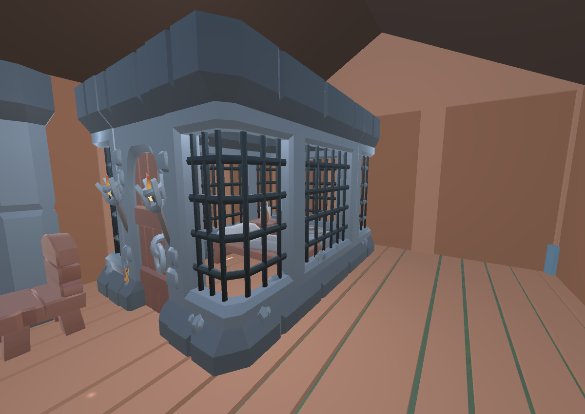
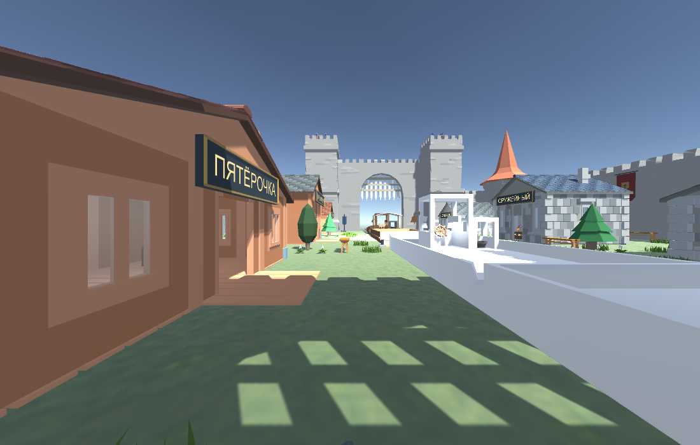
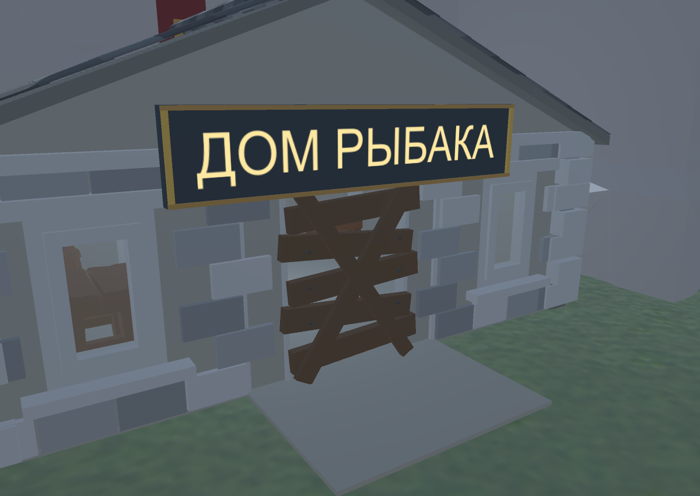
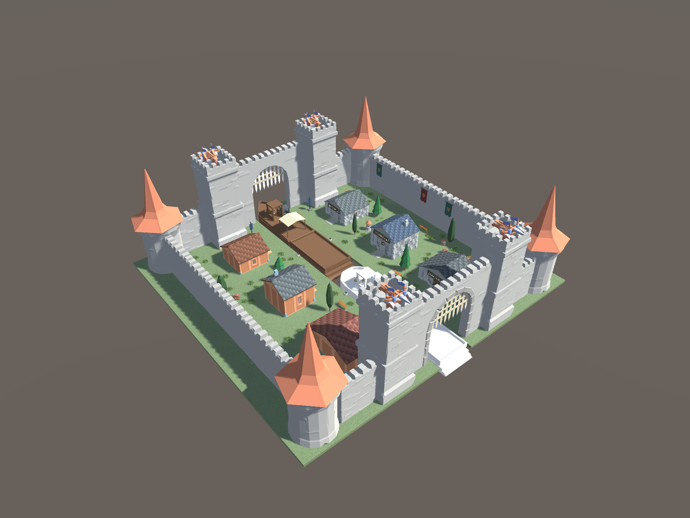
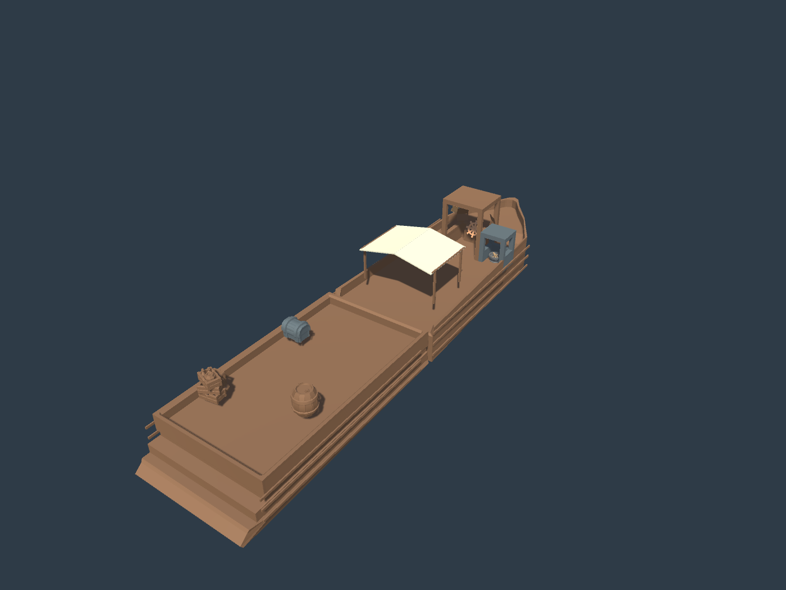

# Замок по существующим игровым зданиям

Обновление DB-ON-087, 2026-10-10: свежие правки владельца сохранены до работы. Рыбак и Пятёрочка получили серую черепицу по исходному торговому дому (SlateTiles_Gray/Light/Dark); торговец — красно-коричневую по оружейной (RustTiles_Base/Light/Dark). Геометрия крыш уже совпадала; изменены ровно три списка материалов Renderer, остальные записи сцены сохранены. Сцена, три отдельных префаба и общий префаб экспортированы, импорт подтверждён. Отчёт — ROOFS087_VALIDATION.txt; визуальная приёмка владельцем ожидается.

Обновление DB-ON-086, 2026-10-10: сдача находок оформлена сундуком, перенесённым из-за прилавка награды; старый прилавок сдачи скрыт, исходные SellPoint/MoneyBagPoint и локализация сохранены. В Пятёрочке три дубовых прилавка с тёмными столешницами и латунной отделкой, три коврика выдачи, зелёный ковёр с ромбами, настенные полки с керамикой и пучки трав. Оригинальный ассортимент и три StorePoint сохранены: уголь постоянный, фонарь/ограда из исходной коллекции; имена и цены приходят из фактического товара. Проходы и девять комбинаций коллайдеров выдачи проверены в Edit Mode. Сцена и отдельные/общий префабы сохранены. Снимки — Supplies_Counters086_Interior.png, Trader_Chest086_Interior.png; отчёт — SHOP_CHEST086_VALIDATION.txt. Приёмка владельцем и игровые проверки после восстановления Fusion ожидаются.

Обновление DB-ON-076, 2026-10-08: текущие правки владельца сначала сохранены, создана резервная копия в Library/WorkshopBackups/DB-ON-076. Семь деревьев теперь масштабированы равномерно относительно исходных префабов: кроны шире, высоты и основания сохранены. Интерьер шерифа имеет единый масштаб 0.5, кровать 0.6 и стул 0.8; клетка остаётся у задней левой стены. Правая декоративная колонна перенесена назад для свободного прохода, контроллер Player прошёл вход и правый проход. Четыре синих флага с опорами придвинуты к реке (x ±4.8) и аркам (z ±22.8). Сцена и общий префаб сохранены, визуальная приёмка ожидается. Отчёт — CASTLE_PROPORTIONS_FLAGS_VALIDATION.txt. Игровая проверка наград остаётся после восстановления сборки.

Обновление DB-ON-075, 2026-10-08: по прямому запросу владельца отменены несохранённые перемещения после DB-ON-074 переоткрытием сохранённой сцены. Верхушки семи деревьев теперь на 0.30 м выше ближайших крыш — 5.30–6.50 м; основания и ширина крон сохранены. Клетка заключённого с кроватью, факелами и ключами сдвинута в задний левый угол шерифа (края local x=−2.60, z=2.60); отдельная мебель перед клеткой сохранена. Триггер приёма врагов следует за клеткой, выдача награды остаётся перед ней. Проход справа проверен контроллером Player. Сцена/префаб сохранены. Отчёт — CASTLE_ROLLBACK_TREES_CELL_VALIDATION.txt; оценка владельцем ожидается.

Обновление DB-ON-074, 2026-10-07: дерево внутри северной башни удалено, семь оставшихся деревьев выше на 18% с сохранением ширины крон и основания. Оба ската навеса деревянной лодки получили твёрдые BoxCollider, в том числе в отдельном лодочном префабе. Контроллер размером с Player стоит на обоих скатах и запрыгивает с края палубы с исходными параметрами прыжка.

Старый интерьер шерифа отключён; в `18_Original_Sheriff_Interior` перенесён набор из настоящего `Sheriffs/GameObject`: решётчатая камера с дверью, кровать, стул, опоры, два факела и ключи. Все 16 MeshRenderer используют исходные меши и материалы. Камера слева, правый проход свободен; SellPoint Enemies остаётся в камере, MoneyBagPoint находится перед камерой. Сцена и общий/лодочный префабы сохранены. Отчёт — `CASTLE_TREES_ROOF_SHERIFF_VALIDATION.txt`. Приёмка владельцем и игровая проверка наград после восстановления сборки ожидаются.

Обновление DB-ON-073, 2026-10-07: сохранены изменения владельца. Преграда Дома Рыбака прилегает к фасаду и увеличена (ширина +23%, высота +12%). 60 существующих пучков травы и 8 бочек/ящиков двора распределены нерегулярно; игровые интерьеры и крупные пользовательские предметы не перетасованы. Сцена и общий префаб обновлены. Проверка пяти доступных входов и закрытого Дома Рыбака прошла с габаритами Player.

### Обход для оценки масштаба

В Unity открыто окно **«Осмотр замка — Player»**. Сначала сфокусировать это окно:

- WASD — ходить, ПКМ с движением мыши — осматриваться.
- Shift — бег, Space — прыжок; Escape отпускает управление.
- «Левый берег» / «Правый берег» — начать на соответствующей стороне; «К началу» — вернуть персонажа.
- «Завершить осмотр» закрывает окно и удаляет временный экземпляр.

Используется временный связанный экземпляр настоящего `Assets/Prefabs/Player.prefab`: исходный CharacterController высотой 1.8 м, радиусом 0.4 м и камера на высоте 1.6 м. Скорость 7, множитель бега 2, прыжок 10, гравитация 9.8 и fallSpeed 2.5 прочитаны из префаба; обход движется через CharacterController с коллизиями, а не свободно летающей камерой. Падение в пустое русло возвращает к началу. Персонаж не сохраняется в сцену/префаб; исходник Player не менялся.

**Это Edit Mode осмотр, не полноценный игровой Play Mode.** Unity сообщает об ошибках компиляции, игровая сборка/Fusion сейчас не загружены. Покупки, лечение, доставка врагов, плавание/лодочное управление не запускаются. Окно работает в текущем сеансе через динамическую компиляцию Unity MCP; после перезапуска Unity до устранения ошибок повторное открытие делает ИИ. После восстановления сборки доступно меню `Tools → Asset Workshop → Walk Castle with Project Player`; полноценный игровой запуск требует основной игровой среды. Исходник окна: `Assets/Editor/AssetWorkshop/CastleWalkPreviewWindow.cs`.

Отчёт — `CASTLE_TERRITORY_WALK_VALIDATION.txt`. Следующий шаг: владелец оценивает обход и восстанавливает игровую сборку; затем ИИ подключает настоящий PlayerMovement в Play Mode.

Обновление DB-ON-072, 2026-10-07: плашки шести вывесок увеличены под исходный размер текста с полями и рамкой. Дом Рыбака сохранён, вход заколочен досками с перекрёстными распорками и заблокирован коллайдером. На боковых стенах изнутри восемь бордовых/тёмно-зелёных знамён со щитами цвета охры: 608 треугольников на весь новый настенный декор, проходы свободны. Сцена и общий префаб обновлены, визуальная приёмка владельцем ожидается. Отчёт — CASTLE_SIGNS_WALLS_VALIDATION.txt.

Обновление DB-ON-071, 2026-10-07: сохранены удаления декора владельцем. 22 надписи TextMesh переведены на WorldTextDepth с проверкой глубины; нативный тест подтвердил полное скрытие за непрозрачной стеной. Семь оставшихся деревьев заменены на Hilly Cedar/Pine из проекта: 3820 → 416 треугольников, расположение и высота сохранены. Сцена и общий префаб обновлены. Отчёт — CASTLE_TEXT_TREES_VALIDATION.txt; визуальная приёмка владельцем ожидается.

2026-10-06, DB-ON-070. Сцена `Assets/Scenes/CastleServicesWorkshop.unity` и общий префаб `Assets/Prefabs/Workshop/CastleServices/CastleServices_01.prefab` обновлены. Эта версия заменяет прежние придуманные сервисы профессий и животных. Основной Castle и игровые исходники сохранены без изменений.

## Реальные здания

Названия взяты из русской `LocalizationData.asset`, состав — из `Assets/Prefabs/Locations/Castle.prefab` и его зданий в `Assets/Prefabs/Locations/Bilding/`.

| Вывеска | Источник | Содержимое и игровые точки | x,z |
|---|---|---|---|
| Пятёрочка | General Store.prefab | Три исходных StorePoint: статический уголь и ассортимент GeneralStore (Lantern, Fence). Показаны модели угля, фонаря и ограды. | −12,−14 |
| Дом Рыбака | Fisherman Shark.prefab | Рыбацкая обстановка: бочки, ящики, стол, удочки. В исходном здании нет подключённого магазина или точки сдачи. | 12,−14 |
| Торговый дом | Trading hut.prefab | Исходный SellPoint типа Items, место сдачи находок и отдельный MoneyBagPoint выплаты; кассовая книга и сундук. | −12,0 |
| Оружейный | Guns Store.prefab | Четыре исходных StorePoint, коллекция GunStore сохранена. На прилавках примеры Pistol, Rifle, Shotgun, AmmoMusket; исходная коллекция также включает AmmoRifle и AmmoShotgun. | 12,0 |
| Шериф | Sheriffs.prefab | Исходный SellPoint типа Enemies и MoneyBagPoint. Камера с решёткой и койкой, стойка получения награды. Принимается EnemyReward, а не произвольный NPC. | −12,14 |
| Больница | Hospital.prefab | Два исходных StorePoint для bandage и Heal; медицинская койка, крест и модели лекарств. Лечение реализовано расходуемыми предметами, отдельного триггера церкви в исходном Castle нет. | 12,14 |

Банк есть в локализации/других механиках, но в составе данного исходного Castle его нет. BankStorePoint покупает валютные наборы; сдача добычи находится в Торговом доме. Названия внутренних корней `04_Professions`, `05_Nursery`, `06_AnimalMerge` исторические: их старые интерьеры и пустые якоря отключены. Новая логика находится в `15_Gameplay_Source`, обстановка — в `16_Run_Interior`.

`15_Gameplay_Source` — связанный экземпляр соответствующего исходного префаба. Сохранены коллекции, сценарии, точки покупки/сдачи и ссылки выплат. Исходный внешний Visual и старая вывеска отключены; точки размещены внутри новых домов. Магазинные Canvas скрыты до появления настоящего товара: исходная логика может включать их.

Модели товаров в `EditorOnly_StockPreview` предназначены для просмотра: лишены игровых скриптов, физики и света, имеют EditorOnly на корне. Runtime StorePoint продолжает создавать настоящий случайный ассортимент. Для проверки в Editor Play Mode эти демонстрационные группы нужно отключить; в сборке EditorOnly удаляются.

## Лодки

Старые демонстрационные лодки удалены из сцены, их ранее сохранённые префабы остаются в каталоге. В русле стоят две полные лодки с прицепом:

- `Assets/Prefabs/Workshop/GameAligned/Board_Game_Reference.prefab` — точная файловая копия исходного BoardController.prefab, сохранённая отдельно для сравнения.
- `Assets/Prefabs/Workshop/GameAligned/Board_CastleCargo_Variant.prefab` — копия полной иерархии с деревянным корпусом, более узким вытянутым носом, обшивкой бортов, полотняным навесом и грузом. Основные игровые узлы сохранены.

| Узел | Положение относительно корня лодки |
|---|---|
| Point: DriverSeatTrigger / место водителя | −0.019, 1.410, 1.580 |
| BoardDefault/Cube (1)/Fire: FuelDeposit | 1.620, 0.330, 1.670 |
| BoardDefault/steering (1): визуальный руль | 0.000, 1.200, 2.630 |

Сравнение выполнялось с исходным BoardController: положения с допуском 0.0001, повороты с допуском 0.001°, масштаб, center/size/isTrigger BoxCollider. Проверки совпадения прошли для обеих лодок. В новом префабе DriverSeatTrigger.trainController и FuelDeposit.trainController указывают на один корневой BoardController; driverSeatTransform указывает на Point.

В сцене Rigidbody лодок имеет isKinematic=true для неподвижного сравнения. Отдельные префабы сохраняют динамический Rigidbody. Две лодки одновременно — выставочная компоновка: при игровом подключении нужен один BoardController, потому что у контроллера singleton. Вода в этой сцене не создаётся, её рисует основная игровая система.

## Сохранение и ограничения

Главная сборка сейчас не загружается: локальный игнорируемый Photon Fusion SDK отсутствует. Редактор показывает основные компоненты как Missing Script. Unity при распаковке теряет их поля и отказывается сохранять такой префаб обычным SaveAsPrefabAsset.

Поэтому новый префаб сериализован из сохранённой геометрии, затем восстановлены 25 исходных записей сценариев и все их внутренние ссылки из исходных файлов. Точки лодки оставлены связанными экземплярами сохранённых префабов в сцене. У BoatShop в исходном базовом префабе старый формат списка предметов: в новой лодке он записан в текущем формате SpecialShopItem с исходными override-предметами и adReward. Исходный BoatShop не изменён. ProBuilder и сохранённые меши корпуса присутствуют.

Общий префаб замка сохраняется графом сериализованных объектов; исходные связанные здания/лодки остаются связанными, а не распаковываются. Все локальные ссылки графа разрешаются. Импорт нового префаба замка через Unity и наличие обеих лодок/зданий проверены.

Проверено: геометрия лодок, соответствие трёх узлов оригиналу, источник каждого здания, число магазинных точек 3/4/2, наличие сдачи и выплаты, проход CharacterController 1.8×0.6 через все шесть дверей, нативные снимки интерьеров. Отчёт: `GAME_ALIGNED_VALIDATION.txt`.

Не проверены игровые транзакции, движение лодки, лечение и доставка врагов в Play Mode: требуется восстановленная основная сборка, игрок и менеджеры основной игры. Следующий шаг — владелец проекта восстанавливает локальный Photon Fusion SDK и оценивает внешний вид; затем ИИ проверяет подключение одной новой лодки и сервисов в игровом окружении. Карточка находится в in_review до приёмки владельцем.
