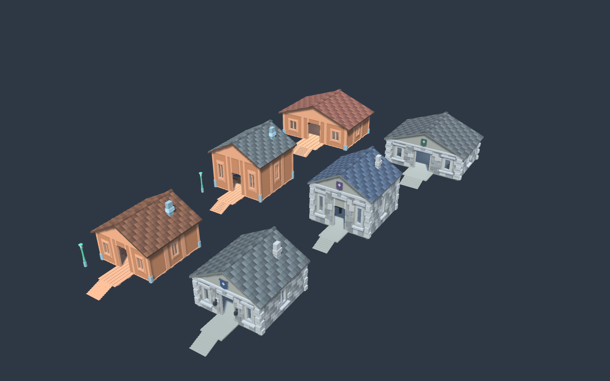
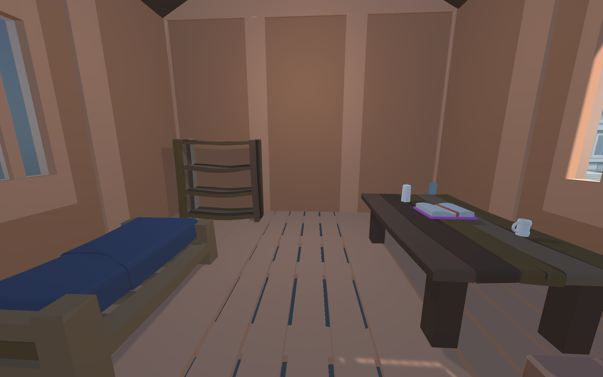
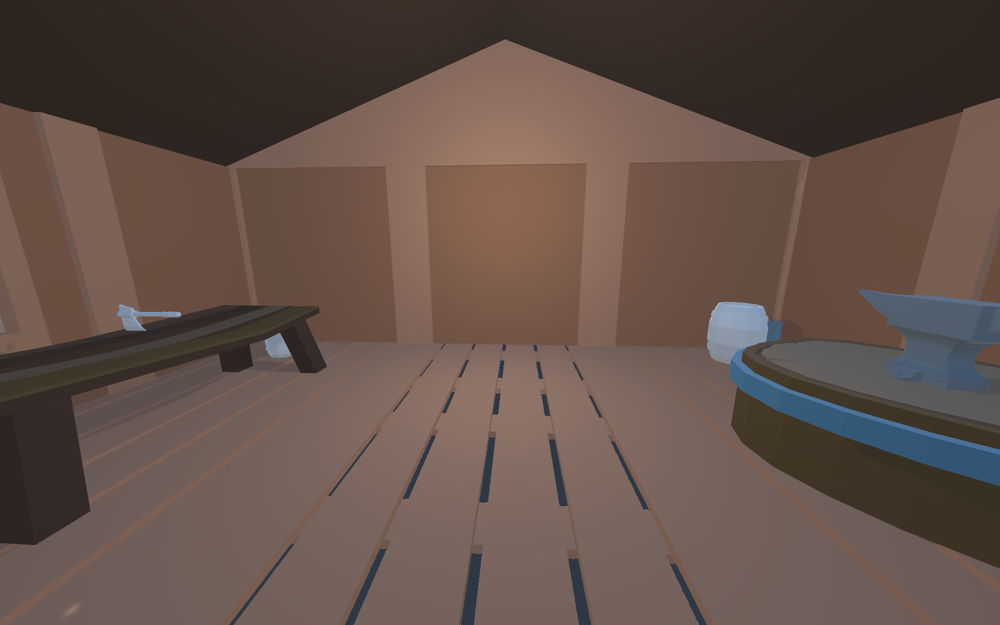
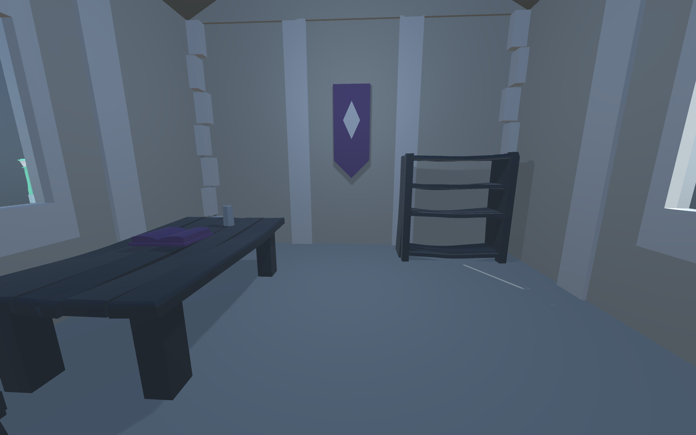
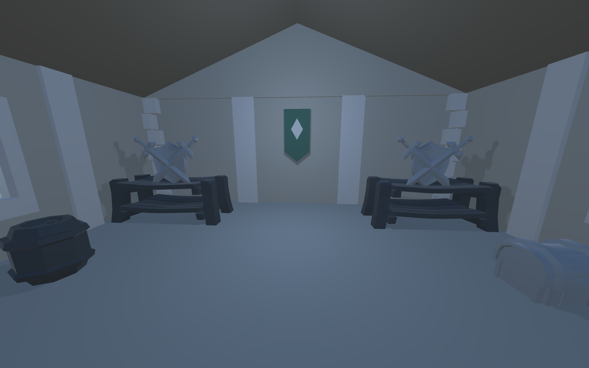

# Коллекция домов для мастерской

2026-10-06, DB-ON-062. В `Assets/Scenes/AssetWorkshop.unity` сохранены шесть отдельных домов, каждый в своём префабе. Все находятся под `01_Assembly_Area`. Два исходных префаба сохранены без изменения содержимого — проверено сравнением SHA256 до и после создания вариантов.

Префабы находятся в **`Assets/Prefabs/Workshop/`**. Размеры ниже — ширина/глубина основного пола и высота стен над полом в единицах Unity; крыльцо, свесы и дымоход в эти размеры не входят. Высокие дома одноэтажные, с просторным залом и потолком 4.0; второго этажа нет.

| Префаб | Пол / потолок | Обстановка | Позиция в сцене (X, Z) |
|---|---|---|---|
| `WoodenCottage_01.prefab` | 6×6 / 2.8 | Первый дом: стол, табуреты, полка, бочка, ящик | 0, 0 |
| `StoneCottage_01.prefab` | 6×6 / 2.8 | Караульная: койка, оружие, сундуки, синие знамёна | 11, 0 |
| `WoodenHall_Tall_02.prefab` | 6×6 / 4.0 | Дом писаря: кровать, письменный стол, табурет, книжная полка, книга, кружка, свечи | 0, 15 |
| `WoodenWorkshop_Wide_03.prefab` | 9×6 / 2.8 | Мастерская: верстак, табурет, наковальня с подставкой, ящики материалов, бочка, инструмент, ведро | 0, 30 |
| `StoneCaptainHall_Tall_02.prefab` | 6×6 / 4.0 | Капитанский зал: рабочий стол, кресло, архивная полка, сундук документов, книга приказов, свечи, фиолетовые знамёна | 12, 15 |
| `StoneArmory_Wide_03.prefab` | 8.4×6 / 2.8 | Оружейная: две стойки оружия, два сундука, стол кладовщика с журналом, запасы, зелёные знамёна | 14, 30 |

Все новые варианты имеют отдельные группы `11_Unique_Interior`. Прежняя обстановка базовых домов отключена только в новых вариантах; исходные два дома не изменены. Ширина архитектуры меняется отдельно от мебели, поэтому предметы сохраняют свои пропорции. У высоких вариантов подняты стены, опоры, кровля/фронтоны/черепица и дымоход; дверной проём сохраняет прежнюю проходимую высоту. У широких вариантов дымоход отключён, крыши имеют более пологий скат.

Крыша дома писаря серая, мастерской — приглушённая красно-коричневая. Капитанский зал имеет синюю кровлю и фиолетовые знамёна, оружейная — графитовую кровлю и зелёные знамёна. У каменных вариантов отсутствуют коричневые активные материалы. Сохраняется закрытая кровля под объёмной черепицей.

## Интерьеры новых вариантов

Проверено через MCP: у каждого нового дома CharacterController (высота 1.8, диаметр 0.6) прошёл от ступеней z=-6.3 до комнаты z=1.3, финальные ноги y=0.5, grounded=True. Верхние raycast кровли: 169/260/169/234 успешных проверок соответственно. В каждом сохранённом префабе четыре прозрачных окна; материалы поддерживаются. Активные коллайдеры: 42/44/42/44. Сцена сохранена, рендеры общего вида и всех четырёх новых интерьеров просмотрены.

Повторяемый рецепт: `tools/assets/CreateUniqueHouseVariants.cs` через MCP script-execute. Он проверяет наличие вариантов перед созданием и не перезаписывает их. Объекты размещены сеткой в три ряда с достаточным расстоянием для осмотра.

Следующий шаг: **владелец** оценивает коллекцию и выбирает дальнейший вариант; **ИИ** детализирует выбранный дом. Полный игровой Play Mode по-прежнему требует отдельного решения существующей проблемы компиляции Fusion.
