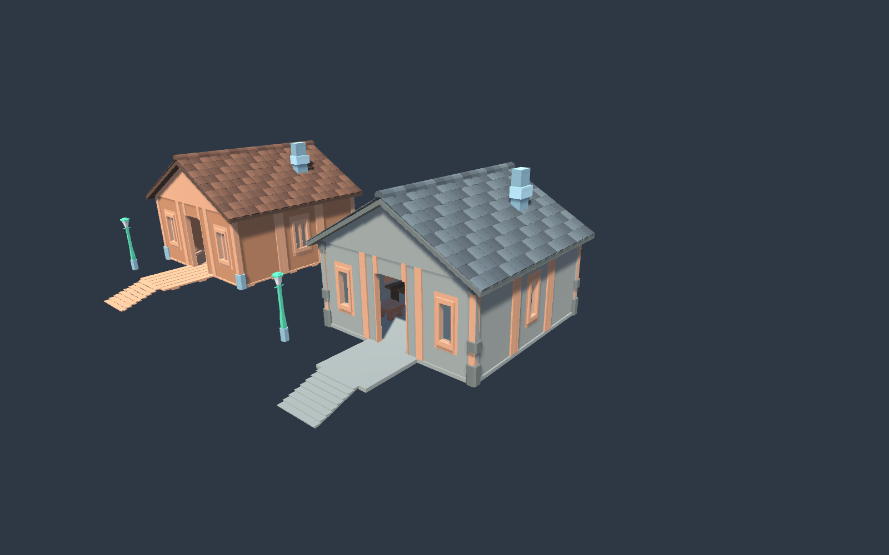
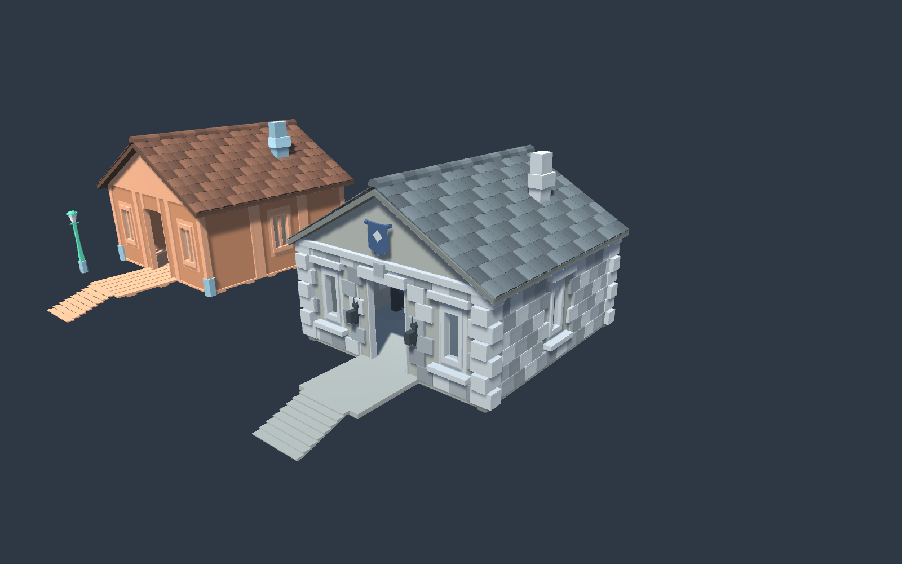
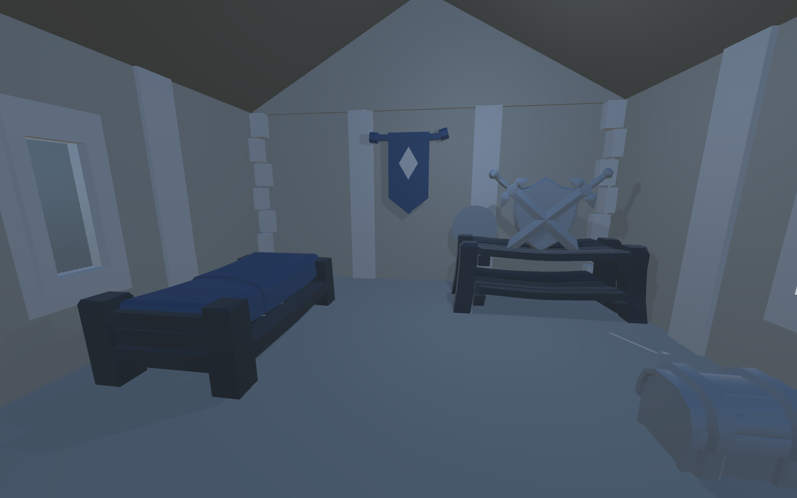

# Каменный дом — второй пример

2026-10-06, DB-ON-124. Сцена: `Assets/Scenes/AssetWorkshop.unity`, объект: `01_Assembly_Area/StoneCottage_01` в x=11. Отдельный сохранённый префаб: `Assets/Prefabs/Workshop/StoneCottage_01.prefab`.

Планировка, проход и небольшая обстановка унаследованы от первого дома. Стены и угловые опоры заменены каменными моделями Kenney Fantasy Town; крыльцо, пол и ступени также каменные. Деревянные оконные рамы и декоративная отделка оставлены как акценты. У крыши тёмно-серая объёмная черепица поверх закрытой кровли.

| Часть | Источник |
|---|---|
| Стены и части дверного проёма | `Assets/Import/kenney_fantasy-town-kit/Models/FBX format/wall.fbx` |
| Стены с окнами | `wallWindowGlass.fbx` в той же папке |
| Угловые опоры | `pillarStone.fbx` в той же папке |
| Ступени | `stairsStone.fbx` в той же папке |
| Пол и настил крыльца | Собственная плита `Assets/Prefabs/Workshop/CottageGeometry/StoneFloorSlab.asset` |
| Закрытая кровля и фронтоны | Ранее созданные меши SealedBrownRoof / SealedWoodGable с отдельными материалами каменного варианта |
| Черепица | Собственный общий меш `CottageRoofTiles.asset`: 270 плиток и 15 коньковых элементов, один Renderer |

Материалы камня, кровли и черепицы находятся в `Assets/Prefabs/Workshop/CottageGeometry`. Исходные модели и материалы набора сохранены. Меши стен имеют отдельные внутренние поверхности; четыре окна прозрачные. В доме 44 активных коллайдера, крупная мебель имеет коллизии.

Проверено через MCP: капсульный маршрут высотой 1.8 / диаметром 0.6 свободен; CharacterController поднялся по ступеням и прошёл внутрь из z=-6.3 до z=1.3 относительно дома, y=0.5, grounded=True. Проверены верхние raycast кровли, поддержка всех материалов и сохранённый префаб. Сцена сохранена. Игровой Play Mode остаётся отдельной проверкой после решения прежней проблемы компиляции Fusion.

Рецепт обоих вариантов и черепицы: `tools/assets/TileRoofsAndBuildStoneCottage.cs`. Повторный Main останавливается, если варианты уже существуют, чтобы сохранить ручные правки. Следующий шаг: **владелец** оценивает каменный стиль и черепицу; **ИИ** дорабатывает пропорции/планировку после выбора.

## Обновление: каменная караульная без коричневой отделки

2026-10-06, DB-ON-061. На запрос владельца фасад детализирован в крепостном стиле, а обстановка заменена на жильё стражи. Префаб остаётся `StoneCottage_01.prefab`, изображения выше показывают прежний вариант.

Группа `10_Castle_Masonry` содержит 317 объёмных блоков, объединённых в один меш: ряды кладки со швами, угловые русты, карниз, подоконники и обрамление проёмов. Блоки исключены из отверстий окон и двери; закрытая кровля осталась прежней. Видимая коричневая отделка заменена серым камнем и сталью через отдельные материалы CastleStone/ CastleIron/ CastleSteel. Общие материалы и деревянный дом не менялись.

В `09_Castle_Guardroom` находятся койка с синей постелью, оружейная стойка с мечами и щитом, два сундука, настенный щит, два знамени с серебристыми эмблемами и два светильника у входа. Источники: модели спальни, стойки, знамен и светильников CatBorg; chest/sword_shield KayKit Dungeon; Shield из 3D Cartoon Village. Ткань знамен и эмблемы созданы отдельно. Для исключения коричневого цвета новые материалы не используют исходные цветные текстуры. Внутри есть мягкий холодный точечный свет. Старые предметы сохранены отключённой группой, садовый фонарь каменного варианта отключён.

Проверено через MCP: свободная капсула в центральном проходе; CharacterController поднялся по ступеням, вошёл и дошёл до z=1.3, y=0.5, grounded=True. В сохранённом префабе четыре прозрачных окна и 42 активных коллайдера. Масштаб предметов и вид снаружи/изнутри проверены рендерами. Цветовой контроль активных материалов не нашёл коричневой палитры. Сцена и префаб сохранены.

Рецепт: `tools/assets/DetailStoneGuardhouse.cs`. Следующий шаг: **владелец** оценивает караульную и детали фасада; **ИИ** дорабатывает выбранные части.
