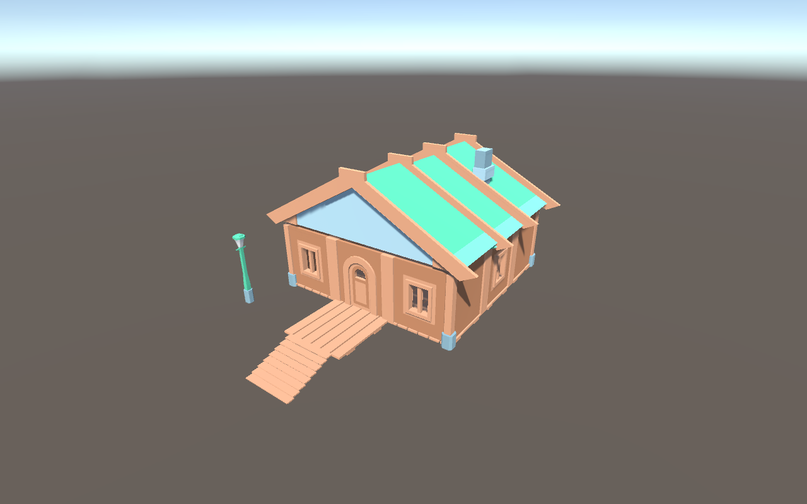
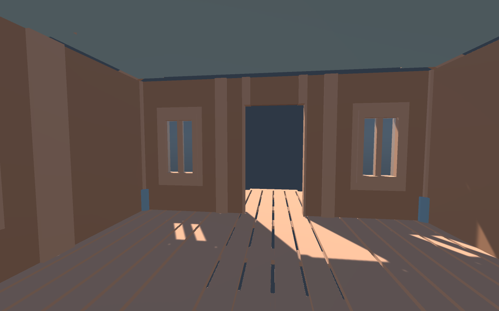
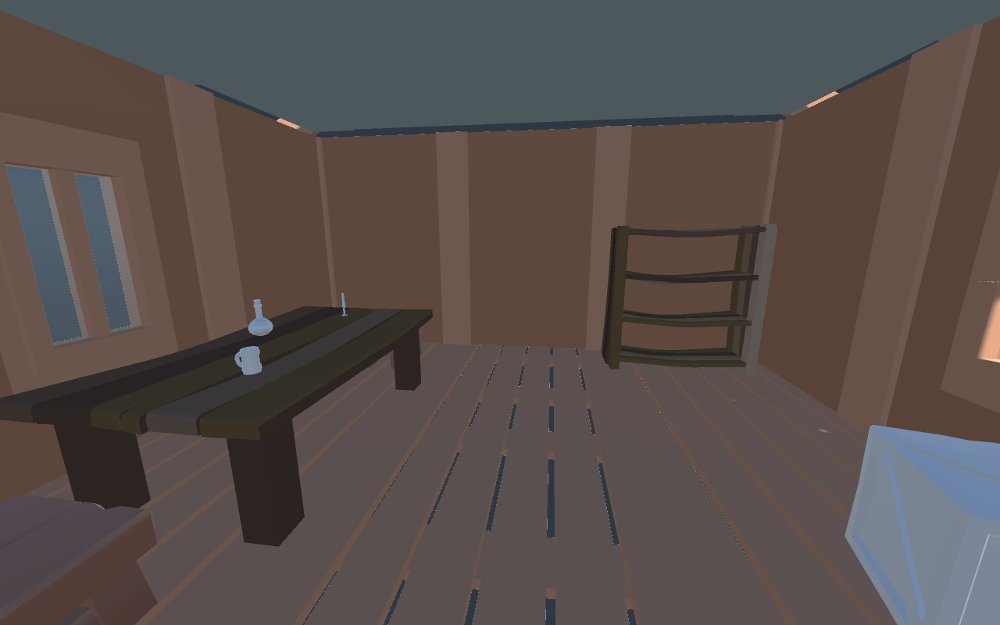
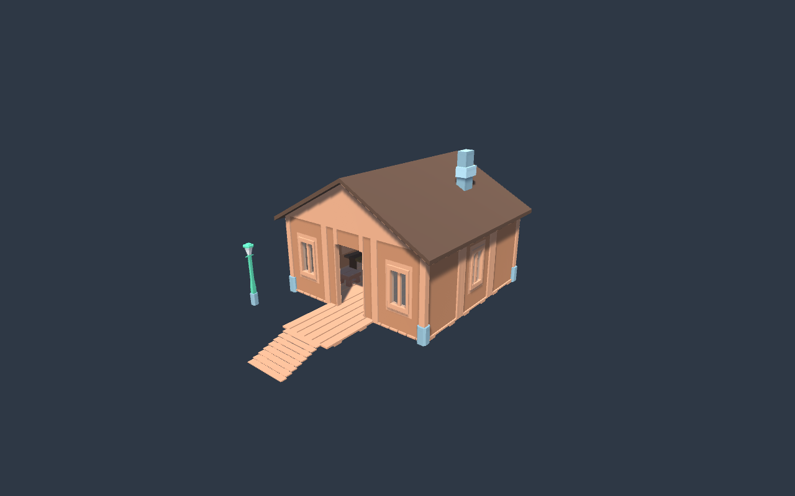
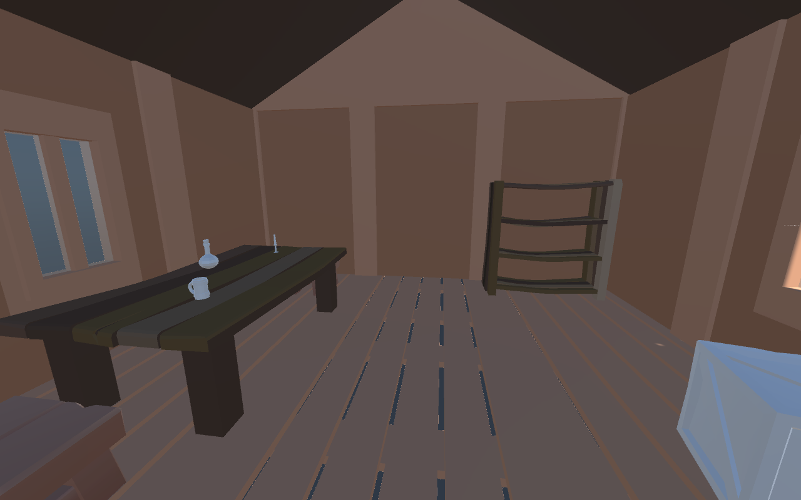
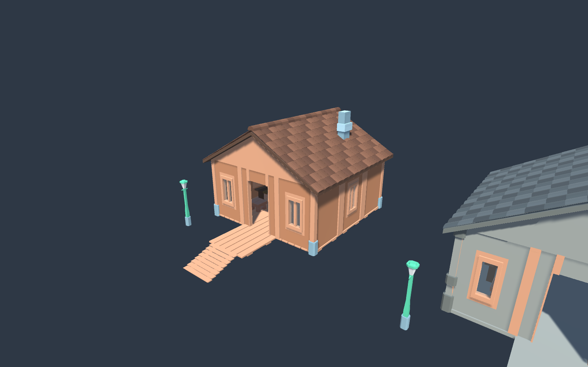

# Первый деревянный дом

2026-10-06, Unity 6000.3.9f1, Edit Mode. Собран по запросу владельца из Kenney Fantasy Town.

Сцена: `Assets/Scenes/AssetWorkshop.unity`. Объект: `01_Assembly_Area/WoodenCottage_01`. Сохранённый префаб: `Assets/Prefabs/Workshop/WoodenCottage_01.prefab`.

Состав: 9 панелей пола, 12 стеновых модулей (дверь и четыре окна), 4 угловые опоры, 3 секции двускатной крыши, настил крыльца, лестница, дымоход, фонарь. Всего 33 MeshFilter. Группы Floor / Walls / Frame / Roof / Porch / Details позволяют менять детали отдельно. Исходные модели сохранены; сборка содержит ссылки на FBX.

## Проверенные размеры

Размеры — Renderer.bounds исходной модели при scale=1, единицы Unity, не размеры коллайдера. Источник: `Assets/Import/kenney_fantasy-town-kit/Models/FBX format/`.

| Модель | Размер X × Y × Z | Особенности и использование в сборке |
|---|---|---|
| planks | 1 × 0.06 × 1 | Пол: scale=2; сетка 2, настил 6×6, верх пола y=0.48 |
| wallWood / wallWoodDoor / wallWoodWindowShutters | 0.1 × 1 × 1 | Scale=2; высота 2, толщина 0.2; исходная стенка находится около x=-0.45, pivot в центре ячейки |
| pillarWood | 0.16 × 1 × 0.16 | Угловые опоры; тонкий профиль относительно стеновой ячейки |
| roofGable | 1.1 × 0.571 × 1.071 | Поперечное растяжение и поворот: крыша покрывает ширину дома |
| stairsWood | 1.02 × 1 × 0.5 | Низкая лестница: масштаб по высоте 0.48, по ширине 3, по длине 1.5 |
| chimney | 0.212 × 1 × 0.34 | Дымоход над крышей, отдельно меняется по высоте |

Положение деталей рассчитывалось по центру Renderer.bounds в X/Z и нижней границе Y, поэтому смещённые pivot стен не создают сдвига на полмодуля. У дома четыре окна: два спереди и по одному сбоку. Фонарь — геометрический пропс у входа, без добавленного источника света.

Проверено через MCP: сцена сохранена, префаб читается, 33 MeshFilter, нет пустых материалов или неподдерживаемых шейдеров; вид со стороны входа проверен скриншотом Scene View. Это первый визуальный образец: коллизии, вход персонажа, интерьер и игровой запуск не проверялись. Дверь не анимирована. В текущем проекте остаётся отдельная проблема компиляции Photon Fusion.

Рецепт сборки: `tools/assets/BuildFirstCottage.cs` запускается через MCP script-execute в открытой мастерской. Повторный запуск останавливается, если дом или префаб уже существует, чтобы сохранить ручные изменения.

Следующий шаг: **владелец** оценивает пропорции и выбирает изменения; **ИИ** дорабатывает выбранную часть (крыша, крыльцо, двор или интерьер).

## Обновление: проход и внутренние поверхности

2026-10-06, DB-ON-121: по следующему запросу владельца дом подготовлен для прохода. Изображение выше показывает первоначальный внешний вариант; ниже — актуальный интерьер.

- Стены подняты до 2.8 над полом, крыша и дымоход подняты на 0.8.
- Закрытая декоративная дверь отключена; открытый вход имеет ширину 1.2 и высоту 2.25. Дверь сохранена внутри префаба для возможного дальнейшего использования.
- Отдельные меши с обратными нормалями обеспечивают видимость внутренних поверхностей. Исходные FBX не менялись.
- Конструкция получила MeshCollider, под настилом и крыльцом добавлена сплошная опора, четыре стекла имеют BoxCollider. В активной сборке 38 коллайдеров.
- В оконные проёмы вставлены прозрачные стёкла с отдельным материалом `Assets/Prefabs/Workshop/CottageGeometry/ClearWindowGlass.mat`, alpha=0.12; деревянные рамы остаются непрозрачными.

Проверки через MCP: 69 свободных положений капсулы (рост 1.8, диаметр 0.6) через проём; стеновые и напольный raycast; CharacterController.Move прошёл ступени и дверь и дошёл из z=-6.3 до z=1.3, ноги y=0.5, grounded=True. На рендере через окно виден внешний красный контрольный объект при включённом стекле (1156 красных пикселей). Временные проверочные объекты удалены. Сцена и обновлённый префаб сохранены.

Рецепт доработки: `tools/assets/MakeCottageWalkable.cs`, через MCP script-execute. Повторный запуск защищён от изменения уже доработанного дома. Геометрия и материалы доработки находятся в `Assets/Prefabs/Workshop/CottageGeometry`.

Это проверки физики в Edit Mode и изображения изнутри, а не ручная приёмка управления игроком в Play Mode. Полный игровой запуск остаётся зависимым от исправления прежних ошибок Fusion. Следующий шаг: **владелец** проверяет вид изнутри и позднее движение своим персонажем; **ИИ** поправляет коллизии и проём, если приёмка выявит проблему.

## Обновление: пример обстановки

2026-10-06, DB-ON-122: отдельная группа `08_Interior_Props` содержит 9 предметов. Стол и два табурета слева, полка у дальней правой стены, бочка и ящик справа; на столе кружка, бутылка и свеча.

| Предмет | Источник | Масштаб / положение |
|---|---|---|
| Стол | `Assets/Import/CatBorg Studio/3D Dungeon Lowpoly Pack/Models/01_DiningHall_01_WoodenTable#1.fbx` | Высота 0.78, слева от прохода |
| Два табурета | `Assets/Models/Item/stool.prefab` | Высота 0.45, у торцов стола |
| Полка | `Assets/Import/CatBorg Studio/3D Dungeon Lowpoly Pack/Models/01_Library_01_BookShelve_1.fbx` | Высота 1.65, у задней стены |
| Бочка и ящик | `Assets/Import/LowPolyMedievalPropsLite/Models/Barrel_01.fbx`, `Box_01.fbx` в той же папке | Высота 0.9 и 0.65, у правой стены |
| Кружка, бутылка, свеча | `Cup_01.fbx`, `Bottle_01.fbx`, `Candle_01.fbx` в той же папке LowPolyMedievalPropsLite/Models | Нижняя грань на столешнице; высота 0.14, 0.28, 0.22 |

У крупных предметов добавлены шесть BoxCollider, общий активный набор коллайдеров дома — 44. Мелкий настольный реквизит декоративный. Свет от свечи не добавлялся. Проверены материалы, отсутствие препятствий на центральной линии и повторный проход CharacterController от ступеней внутрь. Сцена и префаб сохранены; исходные ассеты не изменены. Рецепт: `tools/assets/FurnishCottage.cs`.

Следующий шаг: **владелец** оценивает пример обстановки; **ИИ** меняет размещение или добавляет нужные предметы после выбора владельца.

## Обновление: закрытая коричневая крыша

2026-10-06, DB-ON-123. По замечанию владельца устранены щели в стыках крыши. Первоначальные секции roofGable и roofGableDetail имели разные профили; их выравнивание по нижнему bounds оставляло несовпадение скатов. Теперь старые секции отключены, а группа `04_Roof/Sealed_Roof_Assembly` содержит цельную замкнутую двускатную кровлю и два деревянных фронтона.

Кровля имеет толщину 0.14, свес 0.3 по сторонам и 0.25 по торцам, конёк y=5.0. На стыках с верхом боковых стен геометрия перекрывается примерно на 0.056, фронтоны входят в стену на 0.02. Фронтоны заполнены до внутренней поверхности скатов. Новые материалы `Roof_WarmBrown.mat` и `Roof_InteriorBrown.mat` находятся в `Assets/Prefabs/Workshop/CottageGeometry`; исходные материалы Kenney не менялись.

Проверено: 1404 raycast по кровле и фронтонам; оба меша замкнуты по геометрическим рёбрам (каждое ребро имеет ровно два соседних треугольника); скриншоты изнутри/снаружи без светящихся щелей в стыках. Проход временным CharacterController повторно успешен. Обновлены сцена и префаб. Рецепт: `tools/assets/SealCottageRoof.cs`.

Следующий шаг: **владелец** оценивает стыки и новый цвет; **ИИ** корректирует оттенок или оформление при необходимости.

## Обновление: объёмная черепица

2026-10-06, DB-ON-124. Деревянный дом дополнен черепицей и повторно сохранён в `Assets/Prefabs/Workshop/WoodenCottage_01.prefab`.

В `04_Roof/Sealed_Roof_Assembly/Clay_Tiles` находятся 270 элементов по 9 рядов на каждом скате и 15 полукруглых коньковых элементов. Это объёмная геометрия, объединённая в один меш с тремя близкими оттенками коричневого. Под черепицей осталась прежняя замкнутая кровля. Мебель, прозрачные окна и проход сохранены; CharacterController повторно прошёл ступени и дверь.

Рядом создан [каменный вариант](StoneCottage_01.md). Следующий шаг: **владелец** оценивает черепицу и оба дома; **ИИ** дорабатывает выбранный вариант.
