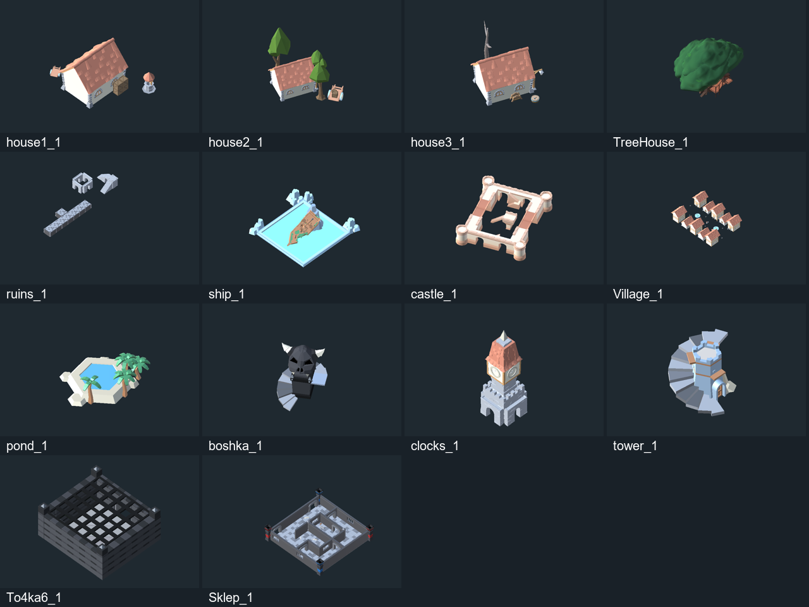

# Места сбора: каталог и устройство

Исследование DB-ON-125, 2026-10-23. Это основа для совместной доработки по одной локации. Игровые префабы, сцены, баланс и Build Settings не изменялись.

## Что проверено

- Git обновлён: `git pull --ff-only` сообщил Already up to date; исходно рабочая копия была чистой.
- Прочитаны текущие генераторы, коллекции и переопределения `GameCollection → Spawners → конкретная сцена`. Значения по умолчанию скрипта часто **не совпадают** с игровыми.
- В Unity 6000.3.9f1 измерена геометрия 98 префабов из `Assets/Prefabs/Locations`, прочитаны NavMeshSurface и три игровые сцены через временные preview scenes. Открытая `LobbyIslandWorkshop` осталась на месте. Игра не запускалась.
- Отрендерены 14 представителей `_1`, изображения просмотрены. Это изолированный вид ассета, без игрового берега, освещения биома и сгенерированной добычи.
- На диске существующие сцены не изменились. При первом создании временных объектов превью открытая LobbyIslandWorkshop получила флаг IsDirty (до исследования false, после true; корневых объектов по-прежнему 14). Сцена не сохранялась и флаг не сбрасывался, чтобы не затронуть возможную параллельную работу владельца. Инструмент исправлен: будущие экземпляры создаются сразу в preview scene.
- Существенное ограничение: в текущем сеансе Editor игровые MonoBehaviour не разрешаются в загруженные типы и на игровых префабах обнаружены Missing Script. `isCompiling=false` не доказывает исправность компиляции. Сохранённые GUID указывают на имеющиеся `.cs`; настройки восстановлены из YAML. Причина отсутствия типов в этом исследовании не исправлялась и заново не установлена. В DB-ON-119 ранее отмечалась проблема Photon Fusion; считать её подтверждённой текущей причиной без отдельной диагностики нельзя.
- Следовательно, правила ниже подтверждены исходниками/сохранённой конфигурацией, размеры и изображения — Editor; поведение текущей сборки и ручная проходимость ещё не проверены.

Данные: [каталог всех вариантов](CATALOG.md), [CSV с врагами и пулами](catalog.csv), [снимок Unity](audit-2026-10-23.json), [сохранённые поля и overrides](serialized-settings-2026-10-23.json). Снимки содержат только данные локаций.

## Какие места существуют

В трёх подключённых игровых биомах используются **14 семейств / 28 префабов**. У каждого два самостоятельно настроенных варианта. Пути: `Assets/Prefabs/Locations/Enemy/<имя>_1.prefab` и `_2.prefab`.

| Семейство | Что видно в префабе | Где появляется по текущему пулу | С чего можно начать улучшение — предложения |
|---|---|---|---|
| `house1` | Дом, ящики, колодец | Лес, пустыня, зима с начала | Читаемый вход, двор и место добычи |
| `house2` | Дом, деревья и колодец | Лес и зима с начала | Сад/лесной двор, маршрут вокруг дома |
| `house3` | Дом с сухим деревом и реквизитом | Все три с начала | Заброшенный двор, отдельная история обстановки |
| `TreeHouse` | Крупное дерево с площадкой | Лес с начала | Понятный подъём и награда наверху |
| `ruins` | Руины; у `_1` дополнительная подземная часть | Лес с начала | Сохранить маршрут, порталы и предметные условия |
| `ship` | Корабль в ограждённом водоёме | Лес после 8000; пустыня с начала (`_2` строго после 0) | Подход к кораблю, палуба, груз |
| `castle` | Крепость | Лес после 18000; пустыня после 14000 | Подход к воротам, двор, маршрут добычи |
| `Village` | Группа домов | Лес после 32000 | Различимые дворы, общий центр, проверка размеров |
| `pond` | Бассейн/оазис, пальмы | Пустыня с начала | Берег, доступ к воде и награде |
| `boshka` | Голова/череп, ступени | Пустыня после 5000; зима после 18000 | Выделить силуэт, безопасный подход/опасную зону |
| `clocks` | Часовая башня | Пустыня после 28000; зима после 10000 | Площадка у башни, детали механизма |
| `tower` | Башня с наружной винтовой лестницей | Зима после 15000 | Проверить подъём и площадку награды |
| `To4ka6` | Тёмная решётчатая клетка/конструкция | Зима с начала | Сначала определить игровое назначение и вход |
| `Sklep` | Склеп/лабиринт; у `_1` рычаг и засада | Зима после 28000 | Читаемые входы и выходы, сохранить сценарий ловушки |

Все пороги — единицы логического пути Unity. В коде они сравниваются строго: `distance > min` и `distance < max`. Имена `To4ka6` и `boshka` технические; новые игровые названия пока не утверждены.

Индивидуальные изображения: [дома 1](previews/house1.png), [2](previews/house2.png), [3](previews/house3.png), [дерево](previews/TreeHouse.png), [руины](previews/ruins.png), [корабль](previews/ship.png), [крепость](previews/castle.png), [деревня](previews/Village.png), [оазис](previews/pond.png), [голова](previews/boshka.png), [часы](previews/clocks.png), [башня](previews/tower.png), [To4ka6](previews/To4ka6.png), [склеп](previews/Sklep.png).

Отдельные категории, которые нельзя смешивать с этими 28 вариантами:

- `Locations/Castle.prefab` — большой город с сервисами (примерно 131×124 по Renderer), отдельный `CitySpawner`. Это другой ассет, чем `Enemy/castle_1/2`.
- `Locations/Land.prefab` — повторяемый участок берега/русла; `Water.prefab` — отдельный водный ассет. Это основа маршрута, а не случайное место добычи.
- `Locations/Bilding` и `Locations/visual` — сервисные здания и визуальные заготовки; наличие файла не доказывает включение в случайный пул.
- `EnemyHouse`, `EnemyHouse_1/2`, `domic 1`, `domic2` не записаны в пулы трёх биомов. Часть служит базой наследования; это не ещё пять готовых встреч.
- Общий `LocationSpawnCollection.asset` — прежний пул на 20 записей. Во всех трёх актуальных сценах он заменён биомным; `LevelMerged` не включён в проверенные Build Settings. Полные старые пороги оставлены в CSV, отдельно от действующих биомов.

## Из чего складывается маршрут

1. `Assets/Scripts/Lobby/Levels.asset` перечисляет Forest → `LevelForest`, Desert → `LevelDesert`, North → `LevelWinter`. Эти три сцены включены в Build Settings вместе с LoadingScene и Lobby.
2. `GameCollection.prefab` содержит `Spawners.prefab`. Его дочерние генераторы занимаются берегом, декором, местами добычи и городами независимо.
3. `LendController` переиспользует три ground-сегмента с шагом **500** по Z. Сзади сегмент переносится вперёд, при движении назад — обратно. Финальная группа отмечена `isFinalLocation` и не зацикливается. Длину предпоследней группы код вычисляет через `GameManager.PlayDistance` и число сегментов. Значения `totalLength: 0` в префабе не означают нулевую длину забега.
4. Геометрический размер `Land` около 564×574 с учётом выступающих деталей, а шаг переиспользования — 500. Это разные величины. Нельзя заменить segmentLength размером Renderer без проверки стыков.
5. `FixCoordinate` периодически сдвигает мир к началу координат. Поэтому физический Transform.z и пройденная дистанция различаются: используются `PlayerAddPos`, `BoardAddPos`, `zPositionFix`. Авторские локальные смещения префаба должны оставаться согласованными с этим механизмом.

Основные файлы: `Assets/Scripts/Locations/LendController.cs`, `FixCoordinate.cs`, `LocationSpawner.cs`, `CitySpawner.cs`, `DecorationSpawner.cs`.

## Когда появляется место добычи

Во всех трёх сценах фактические настройки `LocationSpawner`: **minDistance=300, maxDistance=400, spawnThreshold=500, spawnX=0, spawnY=0, removalDistance=500**. Поля `.cs` со значениями 100–200 и threshold=20 — только defaults, не текущая сцена.

- `lastSpawnZ` увеличивается на случайное расстояние 300–400. Проверка очередного шага начинается, когда `front + 500 > lastSpawnZ`. Это проверка предыдущей отметки: следующая точка может оказаться до примерно 900 единиц впереди front. Не следует понимать threshold как точную дистанцию до нового объекта.
- Сначала выбираются записи с подходящей дистанцией, затем ещё не использованные в текущем цикле. Когда подходящие неиспользованные кончились, цикл заполняется заново. Из них делается выбор по весу `chance`.
- Вес 50 не означает 50%. Повторы исключаются для записи пула, а `_1` и `_2` — разные записи. Поэтому одно семейство может встретиться два раза близко, и строгого чередования берегов нет.
- В лесу 16 записей, в пустыне 14, зимой 16. У большинства вес 50; у `boshka` 30, `tower` 20. Неактивный флаг HaveMin/HaveMax делает сохранённое рядом число несущественным.
- Объект создаётся с **Quaternion.identity**, на X=0, Y=0. Его видимые части уже смещены и повёрнуты внутри префаба. Автоматического случайного yaw, зеркалирования, расширения или вычисления свободной площадки здесь нет.
- Прекращение генерации проверяется по `lastSpawnZ < PlayDistance - spawnThreshold` **до** прибавления следующего интервала. Это не строгая гарантия, что последний объект не зайдёт за границу.
- При обычной одиночной игре front — позиция игрока по пути, rear — дистанция лодки минус 500. Объект удаляется по своей корневой ZPosition, не по задней границе геометрии. Возвращение далеко назад не восстанавливает уже удалённую локацию этим кодом.
- В совместном режиме front/rear берутся из общего состояния. WorldFront учитывает лодку и наиболее продвинувшегося участника; WorldRear монотонно движется за самым отставшим с запасом 1000. При активном контексте до состояния Playing генератор ждёт. Есть догоняющий цикл до 128 шагов за кадр для восстановления участка.
- Генерация в сетевом режиме и ветке SoloRunBranch использует seed-потоки layout/items/enemies и копию коллекции, чтобы не мутировать общий asset. Стабильные ID предметов зависят от индекса локации и точки. Перестановка элементов списков меняет идентичности и результат генерации.

## Стороны и повороты

Условимся: X− — слева при взгляде вдоль +Z, X+ — справа. Почти везде `_1` имеет центр на X−, `_2` на X+. **Исключение — `Sklep`: `_1` справа, `_2` слева.** Суффикс не является программным указателем стороны.

Корни всех 28 префабов: rotation=0, scale=1. Повороты и смещения содержатся в дочерних объектах и overrides. Примеры из Editor:

- `house1_1`: центр геометрии X≈−46.5; `house1_2`: X≈66.3. У дочернего PointCenter второго варианта yaw≈210.28°, а не ровно 180°.
- `Village_2`: PointCenter повёрнут на 90°. Размеры вариантов 262.7×65.1 и 65.1×262.7. Это поворот крупной композиции; нужны проверки поперечного выхода к руслу и продольного соседства.
- `ruins_1` и `_2` отличаются содержанием: один большой габарит включает подземную часть. Их нельзя считать одной моделью, просто развёрнутой на другой берег.

При переносе в мастерскую нельзя центрировать **корень** по видимой модели: корень — якорь пути, а береговой отступ уже зашит внутри. Для удобства камеры использовать bounds, сохраняя pivot. Поворот всей локации вокруг этого якоря изменит сторону, доступ с реки и положение всех точек; это требует отдельного решения, а не косметического действия.

## Размер, зона очистки и расширение

Единого поля `LocationSize` сейчас нет. Есть три независимые вещи:

| Величина | Где задаётся/видна | На что влияет |
|---|---|---|
| Внешняя геометрия | Renderer bounds, Transform и коллайдеры | Видимость, проходы, физическая форма |
| Место, освобождаемое от декора | `ZoneCleaner`, Point1/Point2, halfExtents, слои/теги | Удаление мешающего окружения |
| Интервал встреч | minDistance/maxDistance у спавнера | Расстояния между корнями, не размеры площадок |

Обычно `ZoneCleaner` наследуется от `EnemyHouse_1`: halfExtents=(16.4,1,10), слой 512 (SpawnLocations, №9), forbiddenTags содержит Decoration. Но назначены `_StartPoint` и `_EndPoint`, поэтому **X/Z halfExtents игнорируются**: прямоугольник определяется двумя точками, а halfExtents.y задаёт вертикальную половину высоты. Например `house1_1` имеет Point1=(−67,0,3.4), Point2=(−26.2,0,−24): освобождается область примерно 40.8×27.4, больше геометрии дома 28.4×21.5.

Очистка использует `Physics.OverlapBox` с **Quaternion.identity**. Прямоугольник всегда параллелен мировым осям; при повороте локации нельзя ожидать повёрнутой зоны. Gizmos показывает рамку только при выборе объекта. Первый проход выполняется в Start, затем до пяти повторов с интервалом 1 с в базовой конфигурации. Фактические overrides следует проверять у редактируемого экземпляра.

Удаляются найденные Collider.gameObject с нужным тегом и слоем, не произвольная геометрия в границах. Это очистка постфактум, а не предотвращение пересечений при выборе следующей локации. У городов есть также `CityZoneCleaner` с OnTriggerEnter для Location/Decoration; его триггеры нельзя переносить в рабочую локацию без проверки.

Известная особенность кода ZoneCleaner: если задать только `_centerPoint`, первый проход берёт его, повторные — transform.position. В типовом режиме с Point1/Point2 этой ветки нет. Исправление в исследование не входило.

Порядок расширения одной локации:

1. Сохранить корень и соответствие двух береговых вариантов; редактировать композицию внутри.
2. Изменить землю/настил, стены и реальные коллайдеры; проверить высоту входа со стороны берега.
3. Передвинуть Point1/Point2 и проверить рамку очистки, слой/тег декора, высоту overlap-зоны.
4. Передвинуть/добавить точки добычи и врагов; обязательно включить новые Transform в списки LocationContentSpawner. Дочерний объект с названием SpawnItem сам по себе ничего не создаёт.
5. Проверить NavMeshSurface, данные и NavMeshLink после изменения пола/лестниц. В текущем Editor у pond_2, Sklep_2 и tower_1 обнаружен NavMeshSurface с null navMeshData; у части домов нет собственного surface. Это повод проверить навигацию в рабочем запуске, не доказательство отсутствия навигации во всей сцене.
6. Сопоставить новый продольный размер с интервалом 300–400 и размерами соседей. Спавнер не адаптирует интервал к расширению. Особенно проверить Village_2 длиной около 263.
7. Перепроверить оба берега, подход с воды, вид с лодки, проход игрока и врагов; только после этого подключать переработанный вариант в пул.

`DynamicNavMeshUpdater.Start` умеет BuildNavMesh; подписка на LocationSpawner.Change закомментирована. Нельзя полагаться на автоматическое обновление навигации после каждого нового спавна без проверки конкретной сцены.

## Добыча, враги и баланс

`LocationContentSpawner.Start` один раз создаёт содержимое. Настройка состоит из `itemCollection`, списка itemSpawnPoints (Transform + allowedType + allowedSize), `_enemyPrefabs`, enemySpawnPoints и уровня, установленного генератором до Start.

- ItemType: Any, Weapon, Heal, Fuel, Treasure, Trash, Ammo. Размеры: Any, Small, Medium, Large. Это **фильтр подбираемого предмета**, не размер локации.
- На каждую валидную точку выбирается один подходящий предмет по весам; если подходящих нет или суммарный вес ≤0 — предмета нет. Отдельного поля «процент пустых точек» здесь нет.
- Профиль `Assets/Resources/LocationBalanceProfile.asset` заменяет itemCollection по имени **активной сцены**. Поэтому обычная мастерская с иным именем сама по себе не воспроизведёт добычу леса. Для игрового теста понадобится явный профиль/настройка контекста.
- Яйца получают множитель веса 2.5 и специальную гарантию на первом подходящем месте. В одиночной игре дополнительно участвуют EggSpawnRuntimeState и ProfessionService; в детерминированном режиме есть отдельные условия.
- Враги: список точек перемешивается, для каждой проверяется spawnChance, затем случайно выбирается запись префаба. Повтор одного вида в списке увеличивает его частоту (в CSV повторы сохранены). Уровень ограничивается 1–10.
- Типичные дома: 4 точки добычи, 4–5 врагов; корабль 6/6; крепость 8/6; деревня 25/15. Это число точек, не гарантированное число врагов.

| Биом | Уровень врагов | Предел на локацию | Шанс точки | Ночные count/cooldown |
|---|---|---|---|---|
| Лес | round(level×0.85)−1, затем clamp | 5 | 0.85 | ×0.75 / ×1.25 |
| Пустыня | level | 6 | 0.95 | ×1 / ×1 |
| Зима | round(level×1.05), clamp | 0 означает без отдельного лимита | 1 | ×1.1 / ×0.95 |

Уровень процедуры в детерминированном режиме считается от дистанции появления, в обычной одиночной игре берётся текущий уровень лодки. Night-поля применяются соответствующим ночным спавнером, а не SpawnEnemies этой локации.

## Города и случайное окружение

`CitySpawner` всегда создаёт `Locations/Castle.prefab` на X=Y=0 без поворота. В лесу baseSpawnDistance=5000, additionalDistanceIncrement=0: точки 5000,10000,15000… В пустыне и зимой остаются 9800 и 100: точки 9800,19800,29900… После каждого появления spawnCount увеличивается; новый интервал = base + spawnCount×increment. Буфер появления и удаление сзади — по 500. Число городов вычисляется в Awake от PlayDistance, сохранённое `_citys=10` не окончательное. Для подсчёта числа городов код использует отдельную формулу; строгую привязку последнего города к финишу надо проверить отдельно.

`DecorationSpawner`: каждые 10 единиц пути выбирает точку в полосе X=−150…150, Z=base+500…550; исключаемый прямоугольник X=−10…10, Z=base+499…551. Это значения относительно X лодки/player и очередной отметки baseZ. Коллекция декора заменяется по биому. Удаление через 500 сзади, при старте симулируется предыдущий участок длиной 1000. Через 10 неудачных попыток код выбирает точку уже без гарантии исключения avoidArea. Используется Unity Random; это не тот же детерминированный layout-поток.

## Что уже можно использовать для особенностей

| Механика | Проверенный исходник/ассет | Что даёт и что нужно подключить |
|---|---|---|
| Предметные гнёзда | LocationContentSpawner, LocationSpawnPoint | Отдельные награды на полках, в трудных местах; тип/размер и список точек |
| Триггерный сценарий | `Action/ActivateZone.cs` | UnityEvent при входе/выходе Player; требуется Collider с isTrigger и связи событий |
| Рычаг и анимируемый объект | `Action/Lever.cs`, `ActivateObject.cs`, `Prefabs/Actionitem/Lever.prefab` | Animator trigger Start; анимация и активируемый объект должны быть назначены |
| Предметный ключ/жертвоприношение | `Action/CheckItemOnLocation.cs`, `Prefabs/Actionitem/Podium.prefab` | Проверка ItemData.Name, уничтожение положенного предмета и PutItem event; защита от повторного применения в восстановлении уже есть |
| Засада | `Action/DungeonTrap.cs` | Однократное включение сценария, факелы и пачка врагов по таймеру; собственный уровень врага 1, отдельный от биомного спавнера |
| Освещение | `Action/LightStick.cs`, `DarkZone.cs` | Включение источников и затемнение помещения; DarkZone меняет общие RenderSettings/солнце, не является изолированным локальным эффектом |
| Телепорт | `Locations/InteractPoint/Portal.cs`, `Prefabs/Portals.prefab` | Парные ссылки, эффекты, активация второго через 1 с после перехода |
| Опасная область | `Locations/DamageArea.cs` | Периодический урон стоящему игроку; проверять коллайдеры и мультиплеерное поведение |
| Задания | `Assets/Igrodelnya/QuestSystem` | Есть условия сбора/убийства/взаимодействия и QuestTrigger; новая задача требует определения и событий, один декор её не создаёт |

В сохранённых данных `ruins_1` уже есть 3 Portal, 4 CheckItemOnLocation, DarkZone, DungeonTrap, Lever и 2 ActivateZone. У `Sklep_1` — 5 DungeonTrap, рычаг и ActivateZone с событиями запуска засады. У их вариантов `_2` такой же полноты сценария нет. Эти записи подтверждают существование связок, но их прохождение в текущем редакторе ещё не проверено.

Сетевые идентичности для обычных предметов и врагов уже предусмотрены. Из наличия локальных UnityEvent/Animator нельзя заключать, что состояния рычагов, порталов и всех ловушек реплицируются экипажу или восстанавливаются при reconnect. Перед добавлением такой особенности нужен отдельный сценарий проверки общего состояния.

## Визуальные ресурсы

Полный существующий справочник: [Docs/assets/README.md](../assets/README.md), `inventory.csv` и окно **Tools → Dead Boat → Asset Catalog**. Цифры из DB-ON-119 относятся к снимку 2026-10-06; в этом исследовании полный каталог 5457 файлов заново не пересчитывался. Пути основных наборов и подготовленных префабов проверены в рабочей копии.

| Ресурс | Применение к местам сбора — предложения |
|---|---|
| `Assets/Import/kenney_fantasy-town-kit` | Дома, навесы, мостки, лестницы, заборы, телеги |
| `Assets/Import/kenney_castle-kit` | Стены, башни, ворота и крепостные дворы |
| `Assets/Import/KayKit_DungeonRemastered_1.1_FREE` | Руины, подземные комнаты и переходы |
| `Assets/Import/3D Cartoon Village` | Быстрая перестройка деревни; проверить сочетаемость масштаба |
| `Assets/Import/Polylised - Medieval Desert City` | Оазисы, пустынные фасады, пристань |
| `Assets/Import/LowPolyMedievalPropsLite`, `CatBorg Studio/3D Dungeon Lowpoly Pack`, `Dungeon_Deco_Set-Proto_Series` | Мебель, складской и интерьерный реквизит |
| `Assets/Import/modular_terrain_collection`, `Stones_and_buried_treasure` | Площадка, берег, камни и клад |
| `Assets/Import/KayKit_HalloweenBits_1.0_FREE`, `Assets/AurynSky/Dungeon Pack` | Склеп, мрачные дворы, детали данжа |
| `Assets/Prefabs/Locations/Decoration` | Уже подготовленные деревья, кусты, валуны и горы проекта |
| `Assets/Prefabs/Workshop` | Шесть собранных домов, обставленные сервисы, лодки; брать из существующих примеров перед новой сборкой |

Модель или эффект не гарантирует коллайдер, анимацию или механику. Для каждого добавления проверять материалы текущего pipeline, масштаб относительно игрока, физику и стоимость отрисовки. В частности, Village имеет около 1197 активных Renderer: число нужно учитывать при добавлении мелких деталей.

## Предлагаемая отдельная мастерская

2026-10-23: первый этап реализован в DB-ON-126 — [мастерская house1](WORKSHOP.md), `Assets/Scenes/LocationWorkshop.unity`. Ниже сохранён первоначальный план; переключение биомов и общее интерактивное окно ещё не реализованы. Текущий стенд содержит лесной контекст и оба варианта house1.

В мастерской держать:

- контекст маршрута: копию реального ground-сегмента из выбранного LevelForest/Desert/Winter с его overrides материалов, руслом и берегами; лучше сохранить исходный шаг 500, ограничив рабочую область маркерами, чем сразу обрезать меш;
- поочерёдно один исходный prefab instance на корневом якоре пути и второй вариант для сравнения; не раскладывать все 28 рядом с действующими cleaner;
- лодку/масштаб игрока как визуальные ориентиры, камеру с игрового направления и обзорную камеру;
- рамку активной геометрии с численным X×Z, отдельную рамку очистки и ось X=0; разные цвета для геометрии и очищаемого места;
- переключение биома/варианта и отображение точек добычи, врагов и навигации. Это предложение инструмента; такого общего окна размеров локации в изученных скриптах пока нет.

Порядок совместной работы: выбрать семейство → показать оба исходных варианта с берегом → договориться о характере и механике → работать в новой копии/variant `Assets/Prefabs/Workshop/Locations/` → проверить внешний вид, проходы, точки, навигацию и очистку → перенести проверенный результат в используемый префаб/пул. Если хотим исправить именно общий визуальный источник, сначала проверить, какие ещё локации его наследуют. Не нажимать Apply All на базовый EnemyHouse или импортированную модель вслепую.

Для Edit Mode достаточно сценического окружения. Play Mode всей GameCollection потянет GameManager, SaveManager, Player, Board, FixCoordinate и сетевой контекст. Рабочая визуальная сцена не обязана запускать эту систему; отдельный игровой тест следует делать после восстановления загрузки скриптов и с явным выбором биомного баланса.

Предлагаемый первый разбор — **house1**: небольшой размер, оба берега, все три биома, уже есть подходящие строительные детали и примеры домов. Затем house2/3 и TreeHouse, далее крупные Village/ship/castle, после — сценарные ruins/Sklep. Это предложение порядка, не утверждённый план переделки.

## Воспроизведение и следующий шаг

`tools/assets/AuditRunLocations125.cs`: метод Main снимает геометрию и компоненты в Edit Mode, Capture сохраняет 14 изолированных превью. Запуск через существующий локальный `script-execute`, полная C# class, методы Main/Capture. Затем `python tools/assets/audit_location_yaml.py` разрешает GUID, prefab inheritance/overrides и генерирует CATALOG.md/catalog.csv. Это целевой reader формата Unity, не универсальный YAML-парсер; raw fields/overrides оставлены для проверки результатов. Текущие scene overrides вручную сверены с текстом сцен.

**Выполнено ИИ:** каталог, изображения, исследование кода и сохранённых настроек, размеры, ресурсы и порядок редактирования. **Ожидает владельца:** просмотр и выбор первой локации. **Следующий шаг ИИ после выбора:** создать LocationWorkshop с фрагментом выбранного биома и двумя вариантами выбранного семейства. Перед проверкой игровой механики отдельно выяснить причину Missing Script. Карточка DB-ON-125 остаётся in_review до просмотра владельцем.

Продолжение 2026-10-23: владелец согласовал house1 и создание стенда; мастерская сохранена и открыта, результаты и следующий шаг — в [WORKSHOP.md](WORKSHOP.md) / DB-ON-126.
