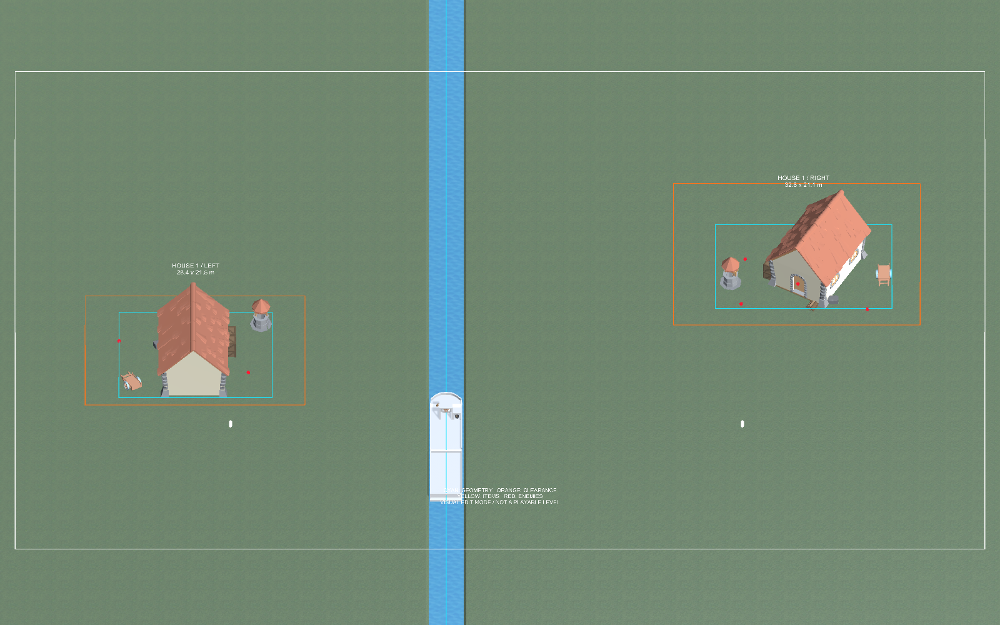

# Мастерская house1

DB-ON-126, 2026-10-23. Сцена: [`Assets/Scenes/LocationWorkshop.unity`](../../Assets/Scenes/LocationWorkshop.unity).

## Что подготовлено

- Отдельная сохранённая сцена, активная в Unity. Build Settings не менялись.
- Реальный сегмент Land из `LevelForest/GameCollection/Spawners/LendController/Land`: исходные координаты, материалы и переопределения лесной сцены, берег и вода. Шаг сегмента 500; белая рамка ограничивает рабочую область 180×120, не обрезая исходный меш. Случайный декор и содержимое спавнеров не запускались.
- Два связанных экземпляра **рабочих копий** префабов: [левый](../../Assets/Prefabs/Workshop/Locations/House1_Left_Workshop.prefab) и [правый](../../Assets/Prefabs/Workshop/Locations/House1_Right_Workshop.prefab). Исходные игровые `house1_1/2` не менялись. Рабочие копии сохраняют исходное prefab-наследование; изменение их overrides не должно применяться ко всему базовому EnemyHouse.
- Оба корня стоят в (0,0,0), rotation=0, scale=1. Их береговые смещения находятся внутри префабов, как в игре. Размер геометрии слева 28.4×21.5, справа 32.8×21.1.
- Лодка с прицепом из реального LevelForest как визуальный ориентир в X=0, Z=−28; две капсулы высотой 1.8 около домов. Это ориентиры масштаба, не игровые персонажи.
- Обзорная камера и отключённая камера со стороны лодки. Свет мастерской отдельный; это удобное авторское освещение, не точная симуляция игрового дня/ночи.

## Что выбирать в Hierarchy

Всё новое находится под `Location_Workshop__House1_Forest`:

| Группа | Назначение |
|---|---|
| `01_Forest_Route_Context__500m` | Снимок берега/воды из основной сцены |
| `02_Working_Prefabs__Edit_These` | Два экземпляра для редактирования |
| `03_Guides__Toggle_For_Clean_View` | Рамки, подписи и точки; выключить целиком для чистого вида |
| `04_Scale_References` | Лодка/прицеп и капсулы роста |
| `05_Cameras_And_Light` | Обзор, камера лодки и освещение |

Голубая рамка — XZ-габарит активной геометрии; оранжевая — прямоугольник очистки по Point1/Point2. Жёлтые сферы — **4 настроенные точки добычи на вариант**, красные — **5 точек врагов на вариант**. Точки внутри дома могут перекрываться крышей; это не отсутствие маркеров. Рамки и сферы не имеют физических коллайдеров. Некоторые подписи и точки лучше видны при приближении.

Это снимок настроек, а не автоматическая живая визуализация. После перемещения геометрии/точек ИИ может вызвать `RefreshGuides` из `tools/assets/BuildLocationWorkshop126.cs` через `script-execute`. Метод перечитывает Transform существующих точек; если меняется состав списков, сначала обновить `tools/assets/house1-workshop-points.tsv` по актуальным полям. Не использовать старые цифры рамок как доказательство нового размера.

## Как править

1. Выбрать нужный экземпляр в `02_Working_Prefabs__Edit_These`. Второй можно временно отключить; соответствующие `Left_Guides`/`Right_Guides` отключаются отдельно.
2. Открыть **рабочий префаб в контексте сцены** через его стрелку в Hierarchy / Prefab Mode in Context. В Project рабочие ассеты лежат в `Assets/Prefabs/Workshop/Locations`.
3. Менять дочернюю композицию, сохраняя корневой якорь. Следить за берегом, входом, Point1/Point2 и точками содержимого. Сохранить рабочий префаб; выйти из Prefab Mode и посмотреть оба варианта с рекой.
4. Для изменения только одного варианта оставлять overrides именно на его рабочем префабе. Apply к базовым EnemyHouse, GunStore или импортированным моделям может затронуть другие локации — это отдельное изменение, его не делать автоматически.
5. Перенос переработанных префабов в биомные пулы — следующий отдельный этап после совместного просмотра и проверки.

Обе стороны сейчас показаны одновременно для сравнения. Это демонстрационный стенд: реальный LocationSpawner выбирает один вариант на очередную дистанцию, не пару напротив друг друга.

## Сохранность и ограничения

Предыдущая `LobbyIslandWorkshop` сохранена **в памяти с исходным IsDirty=true**, не закрывалась и не сохранялась. Новая сцена открыта аддитивно; корни старой временно скрыты через Scene Visibility. Вернуть их можно значком глаза в Hierarchy/Scene Visibility. Текущие камеры мастерской используют отдельную editor scene culling mask, чтобы старый остров не попадал в кадр. Это настройка текущего сеанса; при обычном открытии одной LocationWorkshop лишней сцены нет.

У снимка берега/лодки удалены MonoBehaviour, Missing Script, камеры, звук, источники света и Rigidbody. Перед удалением ProBuilder-компонентов меши скопированы в `ForestContext126.asset`, затем ссылки восстановлены: иначе ProBuilder.OnDestroy очищает MeshFilter. Рабочие дома оставлены редактируемыми, включая их исходные компоненты и ProBuilder; их временные генерируемые меши не нужно путать с независимым статическим контекстом.

Игру не запускали. Missing Script в игровом коде не исправлены; спавн, подбор, бой, сохранения, сетевые состояния и NavMesh-проход игрока здесь не прошли приёмку. В мастерской не запускается GameCollection. Для игровых проверок сначала восстановить загрузку типов и подготовить тестовый контекст с нужным биомным балансом.

## Проверки

- Проверены два prefab instance со ссылками именно на рабочие копии, неизменные корневые координаты, 8 предметных и 10 вражеских маркеров.
- Проверены ненулевые persistent Mesh у снимка берега и отсутствие действующих MonoBehaviour в нём.
- Сохранённая сцена заново открыта через временный preview-контекст: меши земли, воды и лодки, обе prefab-ссылки сохранились. Preview закрыт; активная рабочая сцена осталась открытой.
- Итоговый рендер просмотрен. LocationWorkshop чистая/сохранённая; старая LobbyIslandWorkshop по-прежнему dirty, 14 корней.
- Протокол: [workshop-verification-126.txt](workshop-verification-126.txt). Рецепт сборки/проверок: `tools/assets/BuildLocationWorkshop126.cs`; Main отказывается перезаписывать уже существующую мастерскую.

Следующий шаг: **владелец** — оценить стенд и обозначить желаемый характер дома/двора; **ИИ** — после этого улучшить выбранный вариант house1, затем согласовать второй берег. DB-ON-126 остаётся in_review до просмотра.
